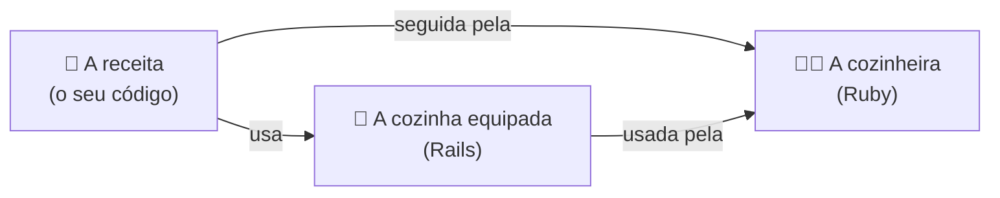
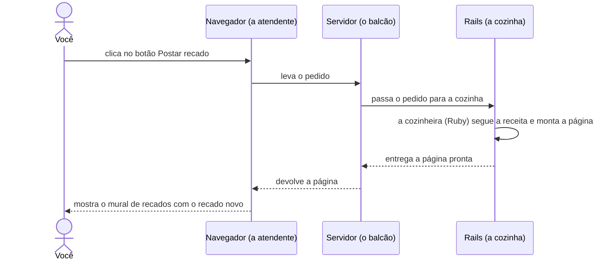

Você já tem um plano para o mural de recados, mas ele ainda está no papel. Como ele vira um site que você abre no navegador e usa de verdade?

Um site começa como **texto**: arquivos com instruções escritas numa linguagem de programação. É parecido com uma receita: sozinha, ela não faz nada; alguém precisa ler e seguir cada passo.

No app Mural de recados:

- O seu código é a **receita**.
- O **Ruby** é a **cozinheira**: entende a linguagem em que a receita está escrita e segue cada passo.
- O **Rails** é uma **cozinha já equipada**, com utensílios e preparos básicos prontos (feitos em Ruby também). Você não precisa fazer a massa do zero: pode se concentrar no que é especial no seu prato.

Mas um site não é um prato que se prepara uma vez só. Ele funciona mais como um restaurante: cada vez que alguém abre o app ou clica num botão, faz um **pedido**, e a página é preparada na hora. Acompanhe um pedido:

Este diagrama é uma versão simplificada. O servidor já vem junto com o Rails: quando você cria um app Rails, ele vem pronto para usar. E, nos próximos capítulos, você vai descobrir o que acontece dentro da cozinha.

Para o app Mural de recados conseguir atender esses pedidos, do que ele precisa?
