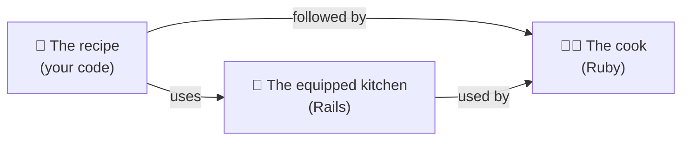
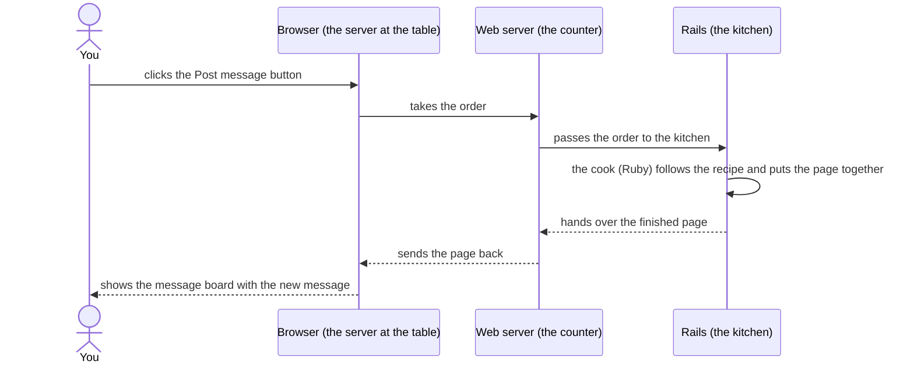

translation_of: _includes/mural-de-recados/01/desafio.md translated_from: 1e3f998 
You already have a plan for the message board, but it's still on paper. How does it become a website that you open in the browser and actually use?

A website starts as **text**: files with instructions written in a programming language. It's like a recipe: on its own, it doesn't do anything; someone needs to read it and follow each step.

In the Message Board app:

- Your code is the **recipe**.
- **Ruby** is the **cook**: it understands the language the recipe is written in and follows each step.
- **Rails** is a **fully equipped kitchen**, with utensils and basic preparations ready to go (also made in Ruby). You don't need to make the dough from scratch: you can focus on what's special about your dish.

But a website isn't a dish you prepare only once. It works more like a restaurant: every time someone opens the app or clicks a button, they place an **order**, and the page is prepared on the spot. Follow an order:

This diagram is a simplified version. The web server comes with Rails: when you create a Rails app, it's ready to use. And, in the next chapters, you'll find out what happens inside the kitchen.

For the Message Board app to be able to serve these orders, what does it need?
