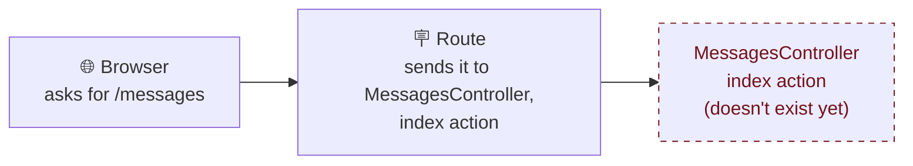
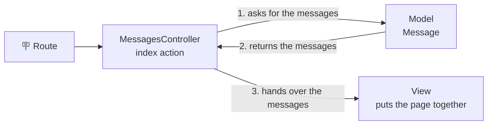
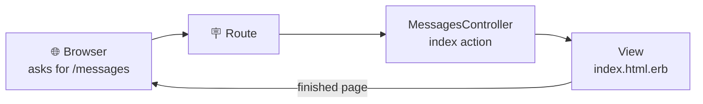

translation_of: _includes/mural-de-recados/03/mao-na-massa.md translated_from: 1e3f998 
Stuck on a step? See [Stuck?](#stuck), at the end of the page.

In this chapter, you're going to see errors show up in the browser, and that's part of it: each error shows the next missing piece. Read each message calmly, because it tells you what's missing.

<details class="passo" markdown="1" open>
<summary>1. Start the server</summary>

Open your codespace and start the server, if it isn't running yet:

```
bin/rails server
```

Open the app in the browser (with the **Open in Browser** message or from the **Ports** tab) and leave that tab open: you're going to reload the page many times in this chapter.

For the other commands, open a new terminal with the **+** button, like in [How do we store the messages?]({{ site.baseurl }}).

**Check:** the browser shows the Rails welcome page, the one from [chapter 01]({{ site.baseurl }}).

Done? Open step **2. Look for the message board**

</details>

<details class="passo" markdown="1">
<summary>2. Look for the message board</summary>

The message board is going to live at the address `/messages`. Let's see what happens if you try to open that address now.

In the app's tab, click the address bar and add `/messages` at the end, after `.app.github.dev`. The address looks something like this:

```
https://your-codespace-3000.app.github.dev/messages
```

Press **Enter**.

**Make a guess:** what's going to show up?

**Check:** an error page shows up, with the title **Routing Error** and the message `No route matches [GET] "/messages"`.

Don't worry: this error is expected! Read the message: Rails is saying there is no **route** for the address `/messages`. It doesn't know what to do with this **[request]({{ site.baseurl }}#request)**, which is the name for what the browser asks the app for. Leave this tab open: you're going to reload this page many times.

Now open step **3. Fix the error: create the route**

</details>

<details class="passo" markdown="1">
<summary>3. Fix the error: create the route</summary>

A **[route]({{ site.baseurl }}#route)** connects an address to a part of the code. It's like a sign that says: "whoever asks for this address, go over there".


{: .ilustracao .ilustracao-secao }

Illustration: [unDraw](https://undraw.co/)
{: .fs-2 .text-center }

In the Explorer, open the file `config/routes.rb`. It has several lines starting with `#`: they're comments, which Rails ignores. Right before the last `end`, add this line, **without** the `#` in front (with the `#`, it becomes a comment and Rails ignores it):

```ruby
get "messages", to: "messages#index"
```

Save the file (**Cmd+S** on a Mac, **Ctrl+S** on Windows and Linux).

This line means: "when someone asks for (`get`) the address `messages`, send them to the `messages` controller, `index` action". `messages#index` is the Rails way of writing "the messages controller, index action".

And why `index`? An *index* is a list. In Rails, `index` is the name normally used for the part that shows a list of things. Since the message board is a list of messages, we chose that name.

**Make a guess:** you created the sign (the route), but you haven't created the controller it points to yet. What do you think will happen when the browser asks for `/messages` again?

Go back to the app's tab, which is at the address `/messages`, and reload the page.

Reloaded the page and saw the new error? Now open step **4. Oh no! A new error!**

</details>

<details class="passo" markdown="1">
<summary>4. Oh no! A new error!</summary>

**Check:** a different error shows up! Progress! Now the error page has the title **ActionDispatch::MissingController in MessagesController#index** and the message `uninitialized constant MessagesController`.

Compare it with the previous error: before, Rails had no route. Now it follows the sign to `MessagesController`… and can't find it, because it doesn't exist yet.



The sign (the route) points to a **[controller]({{ site.baseurl }}#controller)**: the part of the app that receives the browser's request, after the route has sent it along, and decides what to do with it. It's what brings the data together with the visual part of the app: in the message board, it looks up the messages and hands them to the page that shows them. Each thing a controller knows how to do is called an **[action]({{ site.baseurl }}#action)**, and `index`, as you saw in the route, is the one that shows the list. See the other actions in the [glossary]({{ site.baseurl }}#action).



The controller doesn't store the messages or draw the page: it asks the `Message` [model]({{ site.baseurl }}#model), which you created in the previous chapter, for the messages, and hands them to the view, which puts the page together.

Done? Open step **5. Generate the controller**

</details>

<details class="passo" markdown="1">
<summary>5. Generate the controller</summary>

Instead of writing the controller from scratch, let's ask Rails to generate an empty controller, with the `index` action (the list).

**Make a guess:** the `generate model` from the previous chapter created the model and the migration. What do you think `generate controller` will create?

In the new terminal, type:

```
bin/rails generate controller Messages index
```

**Check:** the terminal shows the created files, something like this:

```
create  app/controllers/messages_controller.rb
 route  get "messages/index"
invoke  erb
create    app/views/messages
create    app/views/messages/index.html.erb
invoke  test_unit
create    test/controllers/messages_controller_test.rb
invoke  helper
create    app/helpers/messages_helper.rb
invoke    test_unit
```

The command created:

- `app/controllers/messages_controller.rb`: the **controller**, with the `index` action still empty.
- `app/views/messages/index.html.erb`: the **[view]({{ site.baseurl }}#view)**, the page the `index` action shows.
- one more **route** in `config/routes.rb` (the `route` in the list): you'll tidy that up later, in step 9.
- `app/helpers/messages_helper.rb`: a place for helper functions for the views. We won't use it now.
- `test/controllers/messages_controller_test.rb`: a test file, which we're also skipping for now.

Now reload the `/messages` page.

**Check:** the error is gone! The page shows **Messages#index** and the sentence *Find me in app/views/messages/index.html.erb*. It's the example text Rails put in the view, saying where it is.



The path is now complete: the browser asks for the address, the route sends it to the controller, and the controller uses the view to put together the page that goes back to the browser. Now we still need to show the messages: the page only has the Rails example text.

Done? Open step **6. Show the messages**

</details>

<details class="passo" markdown="1">
<summary>6. Show the messages</summary>

Now let's swap the example text for the real messages.

**In the controller.** Open `app/controllers/messages_controller.rb`. It looks like this:

```ruby
class MessagesController < ApplicationController
  def index
  end
end
```

Inside `def index`, add a line, so it looks like this:

```ruby
class MessagesController < ApplicationController
  def index
    @messages = Message.all
  end
end
```

Save the file. The line `@messages = Message.all` asks the model for all the messages and stores them in a [variable]({{ site.baseurl }}#variable) called `@messages`.

**In the view.** Open `app/views/messages/index.html.erb`, delete the example text and write this in its place:

```erb
<h1>Message Board</h1>

<% @messages.each do |message| %>
  <div>
    <p><%= message.content %></p>
    <p>— <%= message.author %></p>
  </div>
<% end %>
```

Save the file.

- `<h1>` is a heading, in [HTML]({{ site.baseurl }}#html), the language of web pages.
- `@messages.each do |message|` repeats the part below it for **each** message in the list. On each pass, `message` is one message. This is a [loop]({{ site.baseurl }}#loop).
- `message.content` and `message.author` show the text and the author of that message.
- Whatever is between `<%=` and `%>` shows up on the page. Whatever is between `<%` and `%>` (without the `=`) is only run, without showing up.

**Make a guess:** reload the `/messages` page. What's going to show up?

**Check:** the heading **Message Board** and, below it, Ana's message, which you created from the console in the previous chapter. 🎉

Done? Open step **7. Newest first**

</details>

<details class="passo" markdown="1">
<summary>7. Newest first</summary>

Let's post one more message, from the console, to see the order. In the new terminal:

```
bin/rails console
```

```ruby
Message.create(author: "Bia", content: "I loved the workshop!")
```

Now leave the console. Type:

```
exit
```

Then reload the app's page.

**Make a guess:** does Bia's message show up before or after Ana's?

**Check:** it shows up **after**, below Ana's. `Message.all` brings the messages in the order they were stored, from oldest to newest. But our plan asks for the newest first.

Open `app/controllers/messages_controller.rb` again and replace the `@messages` line with:

```ruby
    @messages = Message.order(created_at: :desc)
```

Save and reload the page.

- `order` sorts the messages by a column.
- `created_at` is the column with the date and time each message was created.
- `:desc` means descending: from newest to oldest.

**Check:** now Bia's message shows up first.

Done? Open step **8. What if there aren't any messages?**

</details>

<details class="passo" markdown="1">
<summary>8. What if there aren't any messages?</summary>

**Make a guess:** if there weren't any messages, what would the page show?

Let's find out. To do that, you're going to delete the messages you created from the console. That's fine: in the next chapter, you'll post new messages, this time from the browser.

In the new terminal, open the console:

```
bin/rails console
```

And delete all the messages:

```ruby
Message.destroy_all
```

`destroy_all` deletes **all** the messages at once. Check that none are left:

```ruby
Message.count
```

The console answers `0`. Now leave the console. Type:

```
exit
```

Reload the app's page.

**Check:** only the heading **Message Board** shows up, and nothing else. It looks like the page is broken, and anyone who opens the app won't know what to do.

Let's show an invitation when the message board is empty. In the file `app/views/messages/index.html.erb`, right below the heading, add:

```erb
<% if @messages.empty? %>
  <p>There are no messages yet. How about posting the first one?</p>
<% end %>
```

Save the file.

- `if` means "if": the part inside only shows up **if** the [condition]({{ site.baseurl }}#condition) is true.
- `@messages.empty?` asks whether the list of messages is empty.

**Make a guess:** reload the page. What shows up now?

**Check:** below the heading, the invitation **There are no messages yet. How about posting the first one?** shows up.

Done? Open step **9. Tidy up the route**

</details>

<details class="passo" markdown="1">
<summary>9. Tidy up the route</summary>

The message board already works. Before finishing, there's one thing left over from step 5 that needs tidying up. Open `config/routes.rb` again. Right at the beginning, `generate` added a line:

```ruby
  get "messages/index"
```

**Make a guess:** what does this line do?

Let's find out. It creates the address `/messages/index`. In the address bar, replace the `/messages` at the end with `/messages/index` and press **Enter**.

**Check:** the same message board shows up. In other words, there are now two addresses for the same page. Compare the two routes:

```ruby
  get "messages/index"                    # the generator's
  get "messages", to: "messages#index"     # yours, from step 3
```

Both lead to the same place, but the generator's creates a repeated address with a strange name.

**Why delete it?** Two addresses for the same page make the app more confusing: whoever reads the code isn't sure which one is right, and whoever uses the app can end up with different links to the same thing. Let's keep only your route, which leads to the address we chose: `/messages`.

Delete the line `get "messages/index"` and save the file.

**Make a guess:** and now, what happens to the address `/messages/index`?

**Check:** reload the page. The **Routing Error** shows up, with the message `No route matches [GET] "/messages/index"`: there's no longer a route for that address. Go back to `/messages`: it still works.

Generators help, but they don't always do exactly what you need: reviewing what they created is part of the job.

Done? Open step **10. The message board on the home page**

</details>

<details class="passo" markdown="1">
<summary>10. The message board on the home page</summary>

The message board already works at `/messages`. But anyone who opens the app's main address, with nothing at the end, still sees the Rails welcome page. Let's make the message board the home page.

In `config/routes.rb`, near the end, there's this line:

```ruby
  # root "posts#index"
```

Replace that line with:

```ruby
  root "messages#index"
```

Save the file. `root` defines the app's home page, the address `/`.

`routes.rb` looks something like this (not counting the comment lines):

```ruby
Rails.application.routes.draw do
  get "up" => "rails/health#show", as: :rails_health_check

  get "messages", to: "messages#index"
  root "messages#index"
end
```

**Make a guess:** in the address bar, delete everything after `.app.github.dev` and press **Enter**. What shows up now?

**Check:** instead of the Rails welcome page, the message board shows up. And the address `/messages` still works too.

Done? Open step **11. Save your progress**

</details>

<details class="passo" markdown="1">
<summary>11. Save your progress</summary>

Save your progress with a [commit]({{ site.baseurl }}#commit), like in the **Save your progress** step of [Where do we start?]({{ site.baseurl }}):

1. In the **Source Control** panel, click the **+** next to **Changes** (**Stage All Changes**).
2. Write the message `Show the messages on the board` and click **Commit**.
3. Click **Sync Changes** and, in the window that opens, **OK**.

**Check:** under **Graph**, the commit `Show the messages on the board` shows up with the **main** label and the cloud icon.

</details>

## Stuck?

Open the problem that happened to you:

<details class="pergunta" markdown="1">
<summary>The page keeps showing the error, even after fixing it</summary>

Check that you **saved** the file: in the editor, a file with unsaved changes has a dot instead of the **X** on its tab. Save (**Cmd+S** or **Ctrl+S**) and reload the page.

</details>

<details class="pergunta" markdown="1">
<summary>I got the name wrong in <code>generate controller</code></summary>

Undo what the command created with `bin/rails destroy controller` followed by the name you used (for example, `bin/rails destroy controller Mesages index`) and generate it again with the right name: `Messages`, plural, with a capital M. If in doubt, ask someone on the mentoring team for help. 💜

</details>

<details class="pergunta" markdown="1">
<summary>The page still shows <strong>Messages#index</strong></summary>

The view still has the example text. Check that you deleted that text and saved `app/views/messages/index.html.erb` with the code from step 6.

</details>

<details class="pergunta" markdown="1">
<summary><code>undefined method 'each' for nil</code> shows up</summary>

The view didn't get the messages. Check that the variable has the same name in both files, **with the @**: `@messages` in the controller and `@messages` in the view.

</details>

<details class="pergunta" markdown="1">
<summary><code>undefined method</code> shows up with <code>content</code> or <code>author</code> spelled differently</summary>

Some name is misspelled in the view. Check that it's `message.content` and `message.author`, the same as the names of the columns created in the previous chapter.

</details>

<details class="pergunta" markdown="1">
<summary>The page shows up, but without any messages</summary>

After step 8, that's expected: you deleted the messages on purpose, and the page shows the invitation. In the next chapter, you'll post new messages from the browser.

If the messages disappeared **before** step 8, maybe your database is empty, for example if you created a new codespace. Create a message from the console (`bin/rails console` and `Message.create(author: "Ana", content: "Hi!")`) and reload the page. If in doubt, ask someone on the mentoring team for help. 💜

</details>

Mentors: see the [notes for this chapter]({{ site.baseurl }}).
