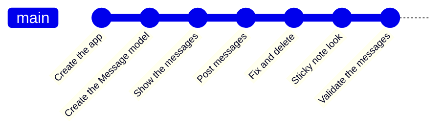
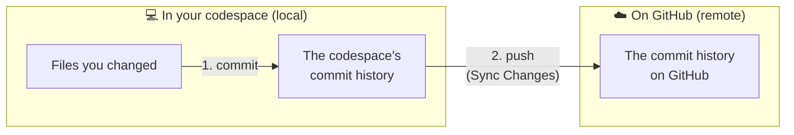
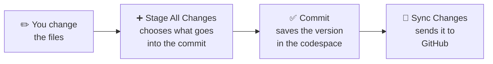
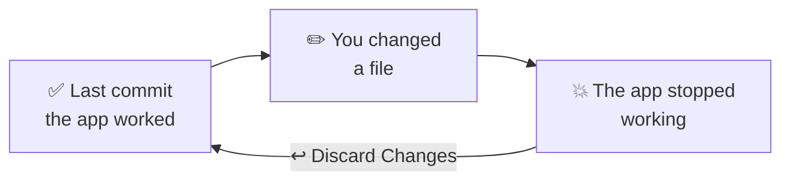

# Git basics

**[Git]({{ site.baseurl }}#git)** saves versions of your project. Every time you finish a part and want to save how it is, you make a **[commit]({{ site.baseurl }}#commit)**: a photo of the project at that moment, with a message saying what changed.

It's like "saving" in a video game: if something goes wrong later, you can go back to the last save point.

In the Message Board project, each chapter ends with a commit. Your repository's history will look something like this, with one dot for each save point:



If something goes wrong in the middle of a chapter, you can go back to the last dot, where everything worked.

## Why use it?

- **Undoing.** If you change something and the app stops working, you can undo it and go back to the last version that worked.
- **Telling the project's story.** Each commit has a message. Together, they show what was done and when.
- **Storing it on GitHub.** The commit lives on your computer, or in your codespace. When you send the commits to [GitHub]({{ site.baseurl }}#github), the project is stored there too, and you can continue from anywhere.

## Commit and push: two stages

Saving your progress has two stages, in two different places:



1. **The commit is local.** It saves a version of the project in your codespace's history. It's fast and doesn't need internet, but it only exists there: if the codespace is deleted, the commits go with it.
2. **The push is remote.** It sends the codespace's commits to your repository on GitHub. From then on, they're also stored on the internet: you can see them on the GitHub website, continue from another computer and, in chapter 08, put the app online.

**Why two stages, and not just one?** Because that way you decide when your commits leave the codespace. You can make several small commits, even without internet, check them and even undo one, and only then send everything to GitHub. And, in a public repository, what you send is visible to anyone.

That's why the guide always asks for both things in the **Save your progress** step: the **Commit** and the **Sync Changes**. A commit without a push is only saved in the codespace, and GitHub doesn't know about it.

**Sync Changes** does a bit more than push: it also brings into the codespace the commits that are on GitHub and aren't in the codespace yet (that's called a **pull**). In the project, only you work on your repository, so you don't need to worry about this: in practice, it just sends your commits.

## In Codespaces

Git already comes installed in the codespace and connected to your repository on GitHub. You don't need to configure anything.

In the project, the guide uses the editor's **Source Control** panel, at the branch icon in the bar on the left. There, you do everything with clicks:




1. Click the **+** next to **Changes** (**Stage All Changes**) to choose what goes into the commit. In the project, everything always goes in.
2. Write the commit message and click **Commit**.
3. Click **Sync Changes** to send the commit to GitHub.

{: .pensando }
Ideally, you review what changed, line by line, before each commit, and choose only what belongs in it. In the **Source Control** panel, you can click each file in the **Changes** list and see the new and deleted lines. At the workshop, to keep it simple, we use **Stage All Changes** and put everything in the commit.

You do this for the first time in [Where do we start?]({{ site.baseurl }}).

<details class="pergunta" markdown="1">
<summary>The same steps, with commands <span class="label label-purple">Going further</span></summary>

The clicks in the **Source Control** panel run Git commands behind the scenes. If you like, you can do the same in the terminal:

| Command | What it does | In the panel |
|---|---|---|
| `git status` | Shows what changed since the last commit. | The **Changes** list |
| `git add .` | Chooses all the changes for the next commit. | **Stage All Changes** (the **+**) |
| `git commit -m "Show the messages on the board"` | Makes the commit, with the message in quotes. | **Commit** |
| `git push` | Sends the commits to GitHub. | **Sync Changes** |

`git status` is the most useful one to use at any moment: it doesn't change anything, it just shows how things are.

</details>

## When to make a commit

In the project, **every chapter ends with a commit**, in a step called **Save your progress**. It's the moment when the message board is working, a little better than before.

A good commit message says what changed, starting with a verb: `Show the messages on the board`, `Post messages through the form`.

## Something went wrong? Undoing changes




If you changed a file, the app stopped working and you want to go back to the last commit:

1. In the **Source Control** panel, hover over the file under **Changes**.
2. Click the curved arrow, **Discard Changes**, and confirm.

The file goes back to how it was in the last commit. From the terminal, the same command is `git restore` followed by the file's name, for example `git restore app/views/messages/index.html.erb`.

{: .atencao }
Discarding deletes the changes to that file since the last commit, and there's no way to get them back. Before doing it, check that it's really what you want. If in doubt, ask someone on the mentoring team for help.

That's why making commits often helps: the more recent the last commit, the less work you lose when going back.

<details class="pergunta" markdown="1">
<summary>What if I already made the commit? <span class="label label-purple">Going further</span></summary>

**Discard Changes** only undoes what hasn't gone into a commit yet. If you already committed a change that went wrong, you can use `git revert`. It doesn't delete the commit: it creates a new commit that undoes the previous one. That way, the history stays complete, and you can even undo the revert itself. In the terminal, to undo the last commit:

```
git revert HEAD --no-edit
```

`--no-edit` uses a ready-made message for the new commit, without opening an editor. Then do **Sync Changes** to send it to GitHub.

</details>

{: .ia }
> Before using code an AI wrote, make a commit of what you already have working. If the AI's code doesn't work, or changes things you didn't ask for, just discard the changes and go back to the save point. Then, at your own pace, try again, with a clearer request or in smaller stages.

## References

- **To learn more:** [Pro Git](https://git-scm.com/book/en/v2), a free book about Git, from the first commit to branches and working with other people.
