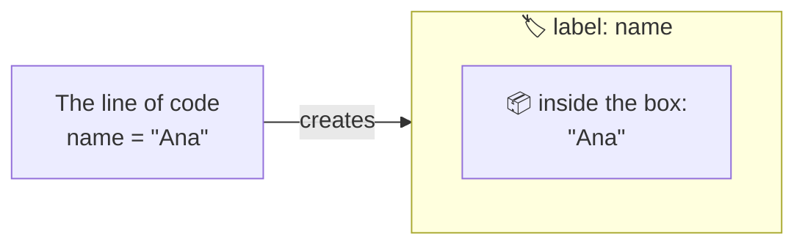
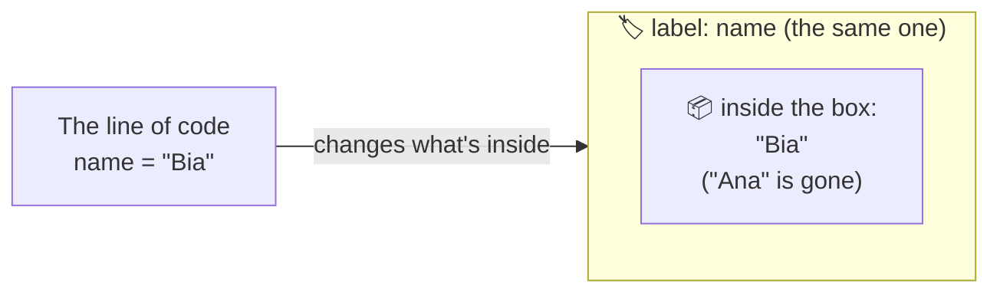

# Ruby, Rails and Git


{: .ilustracao .ilustracao-secao }

Illustration: [unDraw](https://undraw.co/)
{: .fs-2 .text-center }

Before starting the project, it's worth getting to know the three main tools. You don't need to memorize anything: this page is just an overview, and the project shows each one in practice. About a 10-minute read.

## Ruby, the language

**[Ruby]({{ site.baseurl }}#ruby)** is a [programming language]({{ site.baseurl }}#programming-language): a way to write instructions the computer understands. It was created in Japan, in 1995, by Yukihiro Matsumoto, known as Matz, with an idea that became famous: a language that helps programmers enjoy programming and be happy.

That's why Ruby code is usually easy to read, almost like a sentence in English:

```ruby
"Rails Girls".upcase      # => "RAILS GIRLS"
3.times { puts "Hi!" }     # writes "Hi!" three times
name = "Ana"
"Hi, #{name}!"            # => "Hi, Ana!"
```

- `upcase` puts a text in capital letters.
- `3.times` repeats something three times.
- `name = "Ana"` stores a text in a [variable]({{ site.baseurl }}#variable), and `#{name}` puts that text in the middle of another one.
- What comes after `#` is a comment: a note for whoever reads it, which Ruby ignores.

<details class="pergunta" markdown="1">
<summary>What is a variable?</summary>

A **variable** is a name that holds a piece of information to use later. Think of a box with a label. The label is the variable's name, and what's inside the box is the information. For example, the line `name = "Ana"` creates a box with the label `name` and puts the text `"Ana"` inside it. From then on, whenever the code uses `name`, it's as if it used `"Ana"`.



And you can change what's in the box: after `name = "Bia"`, the same `"Hi, #{name}!"` becomes `"Hi, Bia!"`.



</details>

### Why start with Ruby?

Ruby isn't the most used language in the world, but it's a great choice to start with:

- **It's easy to read.** Like in the examples above, the code looks almost like a sentence. That way, you pay attention to the idea, and not to symbols.
- **It's used in big products.** Websites like GitHub and Shopify are made with Ruby and Rails.
- **What you learn applies to other languages.** Variables, databases, Git, reading error messages: all of this repeats in Python, JavaScript and many others.
- **It has a welcoming community.** A famous motto of the community is "*Matz is nice, so we are nice*". Rails Girls itself was born in this community.

## Rails, the framework

**[Rails]({{ site.baseurl }}#rails)**, or **Ruby on Rails**, is a [framework]({{ site.baseurl }}#framework) for building websites and web applications with Ruby. It was created in 2004 by David Heinemeier Hansson and is used on websites like GitHub and Shopify.

A framework comes with what almost every web app needs: receiving the browser's [request]({{ site.baseurl }}#request), storing information in a database, putting the pages together. That way, you focus on what's unique to your app.

Rails also follows [conventions]({{ site.baseurl }}#convention): agreements about what to name things and where to put each file. By following the agreement, it connects the pieces on its own, and you write much less code.

In the project, you'll get to know the main pieces of a Rails app, one per chapter: the [route]({{ site.baseurl }}#route), the [controller]({{ site.baseurl }}#controller), the [view]({{ site.baseurl }}#view), the [model]({{ site.baseurl }}#model) and the [migration]({{ site.baseurl }}#migration). You don't need to understand them now: the names will make sense when you use each one.

## Git and GitHub, to save your progress

**[Git]({{ site.baseurl }}#git)** saves versions of your project, like the save points in a video game. Each saved version is a **commit**. If something goes wrong, you can go back to the last version that worked.

**[GitHub]({{ site.baseurl }}#github)** is a website where you store your project, with all its commits, on the internet. It's similar to Google Drive or Dropbox, but for code, with one difference: it doesn't save on its own. You choose when to save a version (the commit) and when to send it there. That way, you can continue from anywhere, and other people can see your code.

In short: Git is the tool, and GitHub is the place. See how to use both in the project in [Git basics]({{ site.baseurl }}).

## The pre-event talks

Before each workshop, Rails Girls São Paulo holds a pre-event with three talks for participants. The recordings are on the [Rails Girls São Paulo YouTube channel](https://www.youtube.com/@RailsGirls-SP) (in Portuguese), to watch whenever you like.

<!-- TODO: add the links to the recordings or slides of each edition's pre-event talks, with the title and the speaker's name. -->

## What's next?

Go on to [Terminal basics]({{ site.baseurl }}), or start the project with the [Message Board]({{ site.baseurl }}).
