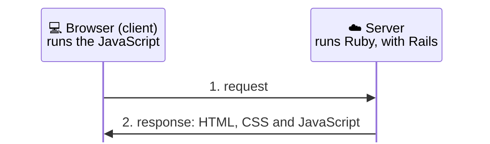
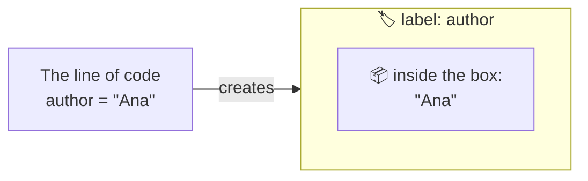
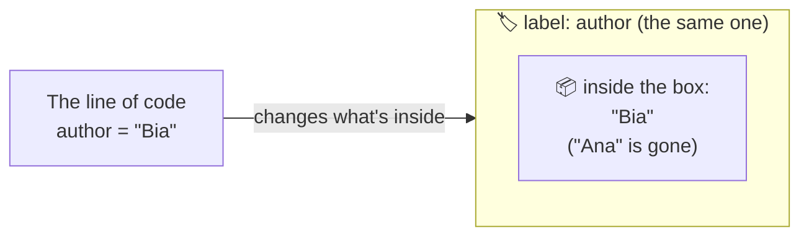

# Glossary


{: .ilustracao .ilustracao-secao }

Illustration: [unDraw](https://undraw.co/)
{: .fs-2 .text-center }

<div class="busca-glossario">
<label for="busca-termo">Search the glossary</label>
<input id="busca-termo" type="search" placeholder="Type a term, like server or route" autocomplete="off">
<p id="busca-vazia" hidden>No term found.</p>
</div>

Terms marked with <span class="label label-purple">Going further</span> aren't needed for the workshop: they're here for anyone who wants to dig deeper.

<div class="grupo-termos" markdown="1">

## How the web works
{: #group-how-the-web-works }

<details class="termo" id="browser" markdown="1">
<summary>Browser</summary>

The **browser** is the program you use to open websites, like Chrome, Firefox, Safari and Edge.

It asks the [server](#server) for the pages and shows the result on the screen. In the analogy from the chapter [Where do we start?]({{ site.baseurl }}), it's the person at the table who takes your order and brings you the finished page.

</details>

<details class="termo" id="request" markdown="1">
<summary>Request</summary>

A **request** is what the [browser](#browser) asks the app for: "show me the `/messages` page", "store this new message". Every time you open an address, click a link or send a form, the browser sends a request.

The app receives the request, decides what to do and sends back a **response**: usually, a finished page. In Rails, what receives the request is the [route](#route), which sends it to the right [controller](#controller).

</details>

<details class="termo" id="server" markdown="1">
<summary>Server</summary>

The word **server** has two meanings:

- **The program** that waits for [requests](#request) from the [browser](#browser) and sends back the pages. In Rails, it's what starts when you run `bin/rails server` (a program called Puma).
- **The computer** where that program runs, which stays on all the time so the website is online. "Putting a website on a server" means leaving it on one of those computers.

In this guide, "the server" almost always means the program.

</details>

<details class="termo" id="deploy" markdown="1">
<summary>Deploy</summary>

**Deploying** is taking the code to the computer where the app runs for people to use, and starting the app again with the new version. Programmers say "do the deploy" or "the deploy failed".

On [Render](#render), every commit sent to GitHub becomes a deploy: it fetches the code, prepares the app and starts it again. You do the message board's first deploy in [How do we show the message board to the world?]({{ site.baseurl }}).

</details>

<details class="termo" id="html" markdown="1">
<summary>HTML</summary>

**HTML** is the language web pages are written in. It says **what** is on the page: a heading, a paragraph, an image, a button, a form.

Each part of the page sits between markers called **tags**, like `<h1>` for a heading and `<p>` for a paragraph:

```html
<h1>Message Board</h1>
<p>I loved the workshop!</p>
```

The [browser](#browser) reads the HTML and shows the page. In Rails, the [views](#view) are HTML files with bits of Ruby mixed in (the `.html.erb` files).

</details>

<details class="termo" id="css" markdown="1">
<summary>CSS</summary>

**CSS** is the language that says **how** the page looks: colors, sizes, fonts, spacing and the position of each thing on the screen.

If [HTML](#html) is the page's content, CSS is the decoration. For example, this rule makes every `<h1>` heading red:

```css
h1 {
  color: red;
}
```

Often, instead of writing all the CSS from scratch, people use a ready-made library, with styles for buttons, cards and forms.

</details>

<details class="termo" id="javascript" markdown="1">
<summary>JavaScript</summary>

**JavaScript** (often shortened to **JS**) is the [programming language](#programming-language) that runs inside the [browser](#browser). It makes the page interactive without loading another page: opening a menu, showing a message when you click, checking a form while you type.

To sum up the three: [HTML](#html) says what's on the page, [CSS](#css) says how it looks, and JavaScript says what it does when you interact with it. [Ruby](#ruby) runs on the [server](#server); JavaScript runs in the browser.



Despite the similar name, JavaScript has nothing to do with Java, which is another language.

</details>

</div>

<div class="grupo-termos" markdown="1">

## Tools
{: #group-tools }

<details class="termo" id="codespace" markdown="1">
<summary>Codespace</summary>

A **codespace** is a computer in the cloud, connected to a [repository](#repository) on [GitHub](#github), which you use through the browser. It already comes with a code editor, a [terminal](#terminal) and the project's tools installed.

At the workshop, your codespace already comes with [Ruby](#ruby) and [Rails](#rails), so you can start programming without installing anything on your computer. The GitHub service that creates codespaces is called **GitHub Codespaces**.

A codespace that sits unused for a long time is deleted by GitHub (by default, after 30 days). That's why you should always save your progress with a [commit](#commit) and send it to GitHub. To program on your own computer, see [On your computer]({{ site.baseurl }}).

</details>

<details class="termo" id="terminal" markdown="1">
<summary>Terminal</summary>

The **terminal** is a way to interact with the computer through text: instead of clicking, you write a **command**, press **Enter**, and the computer answers in writing too. In the codespace, the terminal is at the bottom of the screen and gives orders to the computer in the cloud, not to yours.

It's also called the **command line** or the **shell**. See what it is, why programmers use it so much and the project's commands in [Terminal basics]({{ site.baseurl }}).

</details>

<details class="termo" id="console" markdown="1">
<summary>Console</summary>

In this guide, **console** almost always means the **Rails console**: a way to talk to your app by writing [Ruby](#ruby) code, without going through the browser. You open it with the command `bin/rails console`, inside the [terminal](#terminal).

The terminal understands the computer's commands, like `bin/rails server`. The Rails console, on the other hand, understands Ruby and knows your app: you can write `Message.count` and immediately see how many messages there are. To leave the console and go back to the terminal, type `exit`. You use the console for the first time in [How do we store the messages?]({{ site.baseurl }}).

Outside this guide, the word "console" can also show up with other meanings, like a synonym for terminal or the browser's developer tools panel.

</details>

<details class="termo" id="render" markdown="1">
<summary>Render</summary>

**Render** is a service that hosts and runs apps on the internet. It fetches the code from your [GitHub](#github) repository, prepares the app, starts the [server](#server) and gives it an address, like `https://message-board.onrender.com`, for anyone to open. It also offers databases, like PostgreSQL.

It has a free plan, with limits: the app "goes to sleep" after a while without use, and the free database is deleted after 30 days. It's the service used in [How do we show the message board to the world?]({{ site.baseurl }}). There are many other similar services.

</details>

</div>

<div class="grupo-termos" markdown="1">

## Git and GitHub
{: #group-git-and-github }

<details class="termo" id="git" markdown="1">
<summary>Git</summary>

**Git** is a program that keeps a project's history: each important version is recorded, and you can see what changed, when and why, or go back to an earlier version if something goes wrong.

It's similar to the version history of an online document, with one difference: in Git, you decide when to record a version, and each record gets a message explaining the change. Those records are the [commits](#commit).

Git is not [GitHub](#github): **Git** is the program that keeps the history; **GitHub** is a website that stores projects on the internet. See more in [Git basics]({{ site.baseurl }}).

</details>

<details class="termo" id="github" markdown="1">
<summary>GitHub</summary>

**GitHub** is a website that stores [repositories](#repository) on the internet. With it, your project is saved outside your computer, you can work from anywhere and other people can see the code and collaborate.

Besides storing code, GitHub has several tools. Some that show up in this guide:

- **[Codespaces](#codespace):** computers in the cloud for programming through the browser, like the one you use at the workshop.
- **Pull requests:** requests to change the code, which someone reviews before accepting.
- **GitHub Pages:** publishes websites from a repository. This guide is published that way.

GitHub uses [Git](#git) under the hood, but the two aren't the same thing: Git is the program that keeps the history; GitHub is the website where that history is stored and shared. To create your account, see [Creating a GitHub account]({{ site.baseurl }}).

</details>

<details class="termo" id="commit" markdown="1">
<summary>git commit</summary>

A **commit** is a record of how the project is at a certain moment, with a message saying what changed. For example: `Create the Message Board app`.

Think of a photo album of the project: each commit is a photo, with a caption. If something goes wrong later, you can look at the old photos and go back to one of them.

At first, a commit lives only on the computer where you're working. In the terminal, the command to create a commit is `git commit`. For it to reach GitHub, you need to do a [`git push`](#push-and-pull).

</details>

<details class="termo" id="push-and-pull" markdown="1">
<summary>git push and git pull</summary>

At first, a [commit](#commit) lives only on the computer where you're working (at the workshop, the codespace). For it to reach [GitHub](#github), you need to send it:

- **push**: sends your commits to GitHub;
- **pull**: brings from GitHub the commits you don't have on your computer yet.

In the terminal, the commands are `git push` and `git pull`. In the Source Control panel, the **Sync Changes** button does both at once: first the pull, then the push. That's what the window that shows up in the **Save your progress** step of [Hands-on]({{ site.baseurl }}) says: "This action will pull and push commits".

</details>

<details class="termo" id="repository" markdown="1">
<summary>Repository</summary>

A **repository** is a project's folder together with its whole history, that is, all its [commits](#commit).

It can live on your computer and also on a website like GitHub, where other people can see the code and help. In the Message Board project, your repository is called `message-board` and was created from a Rails Girls SP template.

</details>

</div>

<div class="grupo-termos" markdown="1">

## Rails
{: #group-rails }

<details class="termo" id="framework" markdown="1">
<summary>Framework</summary>

A **framework** is a set of ready-made tools and rules for solving problems almost every project has, so you can focus on what's unique to yours.

Instead of building from scratch how the app receives requests, stores data and puts pages together, you use what the framework already brings and follow the way of organizing things it suggests. It's like cooking in a kitchen that's already equipped, instead of starting by building the stove.

[Rails](#rails) is a framework.

</details>

<details class="termo" id="rails" markdown="1">
<summary>Rails</summary>

**Rails**, or **Ruby on Rails**, is a [framework](#framework) for building web applications, written in the Ruby language. It has existed since 2004 and is used on websites like GitHub and Shopify.

It organizes the app into parts with well-defined roles ([route](#route), [controller](#controller), [model](#model) and [view](#view)) and comes with ready-made commands, like `rails new`, which creates the structure of a whole app.

</details>

<details class="termo" id="convention" markdown="1">
<summary>Convention</summary>

A **convention** is an agreement about how to do things: what name to give, which folder to put each file in. Nobody has to follow it, but when you do, everyone understands each other without needing to explain.

[Rails](#rails) uses many conventions. If you follow the agreement, it finds and connects the pieces on its own, without you configuring anything. In the Message Board app, for example:

- the `Message` [model](#model), singular, uses the `messages` table, plural;
- the [route](#route) `messages#index` leads to `MessagesController`, [action](#action) `index`;
- the `index` action shows the [view](#view) in `app/views/messages/index.html.erb`.

Rails programmers sum this idea up as *convention over configuration*.

</details>

<details class="termo" id="route" markdown="1">
<summary>Route</summary>

A **route** connects an address to a part of the code. It's like a sign that says: "whoever asks for this address, go over there". When the browser asks for `/messages` (the list of messages), the route says which [controller](#controller) and which [action](#action) will take care of that [request](#request).

The route looks at two things: the request's **address** and **verb**, which says what the browser wants to do. The same address can lead to different actions:

| Verb | Address | Action |
|---|---|---|
| `GET` | `/messages` | `index`: shows the messages |
| `POST` | `/messages` | `create`: stores a new message |

All the routes live in a single file, `config/routes.rb`. See the full table, with all the verbs, in [What happened?]({{ site.baseurl }}) for chapter 05.

</details>

<details class="termo" id="controller" markdown="1">
<summary>Controller</summary>

The **controller** is the part of the app that receives the browser's [request](#request), after the [route](#route) has sent it along, and decides what to do with it. It's what brings the data together with the visual part of the app: for example, it looks up the messages in the [model](#model) and hands them to the [view](#view), which puts the page together.

Think of the person who serves you at a restaurant: they take the order, bring it to the kitchen and bring the finished dish to the table. That person doesn't cook or store the ingredients, but makes sure the order reaches whoever handles it and brings back the result.

In the Message Board app, the controller for the messages is called `MessagesController`.

</details>

<details class="termo" id="action" markdown="1">
<summary>Action</summary>

An **action** is each thing a [controller](#controller) knows how to do. For example, the `index` action of `MessagesController` shows the list of messages.

In Rails, actions have names that follow a [convention](#convention). These are the most common:

| Action | What it does | In the Message Board |
|---|---|---|
| `index` | shows the list of items | see all the messages |
| `show` | shows a single item | (the app doesn't use it) |
| `new` | shows the form to create an item | open the New message page |
| `create` | stores the new item | post the message |
| `edit` | shows the form to change an item | open a message to fix it |
| `update` | stores the changes | save the fix |
| `destroy` | deletes the item | delete a message |

Together, these actions make up [CRUD](#crud): create (`new` and `create`), read (`index` and `show`), update (`edit` and `update`) and delete (`destroy`).

</details>

<details class="termo" id="model" markdown="1">
<summary>Model</summary>

The **model** is the part of the app that represents the information and the rules about it. It's what talks to the [database](#database) to store and look up data.

In the Message Board app, the `Message` model knows that a message has an `author` and `content` (the text of the message). The rules live in it too, like "a message can't be empty".

</details>

<details class="termo" id="validation" markdown="1">
<summary>Validation</summary>

A **validation** is a rule that says whether a piece of information can be stored. For example: "a message needs the name of the person who wrote it" or "the text can have at most 280 characters". If the rule isn't met, the app rejects the information and says what's missing.

In Rails, validations live in the [model](#model), with `validates`. You write the first ones in the chapter [What if someone sends an empty message?]({{ site.baseurl }}).

</details>

<details class="termo" id="view" markdown="1">
<summary>View</summary>

The **view** is the part of the app that puts together what shows up on the screen. In the Message Board app, it's the view that shows the form and the cards with the messages.

It receives the information from the [controller](#controller) and only takes care of the presentation. In the kitchen, it would be plating the dish: the ingredients are already prepared, and the view decides how they look.

</details>

<details class="termo" id="mvc" markdown="1">
<summary>MVC (Model-View-Controller) <span class="label label-purple">Going further</span></summary>

**MVC** (*Model-View-Controller*) is a way to organize an app in three parts, each with its own responsibility:

| Part | Responsibility | In the Message Board app |
|---|---|---|
| [Model](#model) | The data and the rules about it | `Message`: what a message has and what a valid message is |
| [View](#view) | What shows up on the screen | `index.html.erb`: how the messages look |
| [Controller](#controller) | Receives the [request](#request) and connects the model to the view | `MessagesController`: looks up the messages and hands them to the view |

Rails follows this pattern, and that's why the app has the folders `app/models`, `app/views` and `app/controllers`. Keeping the parts separate helps you change how things look without touching the data, and know where to look for each problem.

The [route](#route) isn't part of MVC: it comes before, and chooses which controller will take care of each address.

</details>

</div>

<div class="grupo-termos" markdown="1">

## Database
{: #group-database }

<details class="termo" id="database" markdown="1">
<summary>Database</summary>

The **database** is where the app stores information so it doesn't disappear when someone closes the browser. In the Message Board app, it's where the messages live.

You can think of it as a spreadsheet: each kind of information gets a **table**, each message is a **row** and each piece of information in the message, like the author and the text, is a **column**.

For example, the `messages` table of the Message Board app:

| id | author | content |
|---|---|---|
| 1 | Ana | Welcome to the message board! |
| 2 | Bia | Today I made my first app! |
| 3 | Carla | Anyone want to study Rails with me? |

But a database is much smarter than a spreadsheet. It's like having several linked spreadsheets: one table can point to the rows of another. For example, a table of replies can say which message each reply belongs to. The database also finds information really fast, even among millions of rows, lets many people use it at the same time without getting in each other's way and follows rules that prevent wrong data, like a row missing a required piece of information.

The Message Board app uses **SQLite**, a database that lives in a single file inside the project and that Rails already sets up.

</details>

<details class="termo" id="persistence" markdown="1">
<summary>Data persistence</summary>

**Persistence** is an app's ability to store information in a way that it keeps existing after the app is closed or restarted. When a message stays on the message board even after the person closes the browser, or the next day, the data is **persisted**.

In Rails, what takes care of this is the [model](#model), which stores and looks up information in the [database](#database).

</details>

<details class="termo" id="migration" markdown="1">
<summary>Migration</summary>

A **migration** is a file with instructions to change the structure of the [database](#database): create a table, add a column, change the type of a piece of information.

Think of the assembly manual for a piece of furniture: instead of putting it together your own way, you follow the manual's steps, one after the other. Anyone with the same manual builds the same piece of furniture from scratch. Migrations are the steps of the database's manual: each one says what to change, like "create the messages table, with the author and content columns".

Migrations are kept one after the other, and that's why they work as a **history of the changes** to the database: you can see what changed, when and in what order. And, by following that history, anyone can build the same database from scratch.

In Rails, migrations live in the `db/migrate` folder, and you apply the ones that haven't run yet with the command `bin/rails db:migrate`.

</details>

</div>

<div class="grupo-termos" markdown="1">

## Tests
{: #group-tests }

<details class="termo" id="automated-test" markdown="1">
<summary>Automated test <span class="label label-purple">Going further</span></summary>

An **automated test** is a small program that checks whether another part of the code works as it should. For example: a test can try to save an empty message and check that the app rejects it.

Think of a checklist that checks itself: instead of you opening the app and testing everything with the mouse after every change, the tests do it in seconds, always the same way. If something that used to work breaks, they let you know.

`rails new` already creates a `test` folder in the project, and the tests run with the command `bin/rails test`. In the Message Board, we don't write tests yet: the checking is done by hand, in the **Check** and **Break it on purpose** steps.

</details>

<details class="termo" id="ci" markdown="1">
<summary>CI (continuous integration) <span class="label label-purple">Going further</span></summary>

**CI** stands for *continuous integration*: running the [tests](#automated-test) and other checks automatically every time someone sends new code to [GitHub](#github).

On GitHub, what runs these checks is **GitHub Actions**. The result shows up next to the commit: a green ✅ when everything passed and a red ❌ when some check failed.

In a real project, a ❌ is a warning to take seriously: someone looks at what failed and fixes it before moving on. `rails new` already leaves a CI configuration ready, in the file `.github/workflows/ci.yml`, but, for now, the workshop project doesn't use automated tests. So if a ❌ shows up in your repository, it comes from those checks the project doesn't use yet, and not from something you did wrong.

</details>

</div>

<div class="grupo-termos" markdown="1">

## Programming
{: #group-programming }

<details class="termo" id="program" markdown="1">
<summary>Computer program (or app)</summary>

A **program** is a set of instructions the computer follows to do some task. It's also called **software**, an **application** or an **app**.

The browser, WhatsApp and the Message Board itself are programs. Some run on your computer or phone; others, like websites and web apps, run on a [server](#server), and you use them through the [browser](#browser).

A program's instructions are written in a [programming language](#programming-language). It's the recipe from the analogy in the chapter [Where do we start?]({{ site.baseurl }}): on its own it doesn't do anything, someone needs to follow it.

</details>

<details class="termo" id="programming-language" markdown="1">
<summary>Programming language</summary>

A **programming language** is a way to write instructions the computer can follow. Code is text, written with the words and symbols of that language.

It's similar to a language like English, only much stricter: each word has an exact meaning, and a misplaced comma can make the computer understand nothing. That's why error messages are so common, and learning to read them is part of programming.

There are many languages, each with its own strengths. Some examples: [Ruby](#ruby), Python and JavaScript.

</details>

<details class="termo" id="ruby" markdown="1">
<summary>Ruby</summary>

**Ruby** is the [programming language](#programming-language) used in this guide. It was created in Japan, by Yukihiro Matsumoto, and released in 1995, with a stated goal: to be pleasant for programmers.

Ruby code is usually easy to read, almost like a sentence in English. For example:

```ruby
3.times { puts "Hello!" }
```

This code shows "Hello!" three times.

[Rails](#rails) is written in Ruby, and so is your app's code. In the analogy from the chapter [Where do we start?]({{ site.baseurl }}), Ruby is the cook who reads and follows the recipe.

</details>

<details class="termo" id="open-source" markdown="1">
<summary>Open source and free software <span class="label label-purple">Going further</span></summary>

A program is **open source** when its code is available for anyone to look at, change and redistribute. The idea is practical: with open code, more people collaborate, and the program gets better. Ruby and Rails are like that: you can see all the code of [Ruby](https://github.com/ruby/ruby) and [Rails](https://github.com/rails/rails) on GitHub.

What says what you can do with some code is the **license**, a text that comes with the project. Code you can see isn't the same as open code: a public repository on GitHub without a license can be read, but can't be copied or used in your project without permission.

**Free software** goes further: it's a movement that defends, as a matter of principle, that whoever uses a program should be free to use, study, change and share it. And "free" doesn't mean "no cost": it means free to use and change.

There are two main kinds of free software licenses, and they work in different ways. **Copyleft** licenses, like the GPL, require modified versions to stay open, with the same freedoms. **Permissive** ones, like the MIT license, which Rails uses, let the code be used even in closed programs.

Open projects are made by communities: anyone can suggest a change, fix a bug or improve the documentation. It's a great way to keep learning after the workshop: see [How to Contribute to Open Source](https://opensource.guide/how-to-contribute/), a guide by GitHub.

See more in [Free software](https://en.wikipedia.org/wiki/Free_software), on Wikipedia.

</details>

<details class="termo" id="indentation" markdown="1">
<summary>Indentation</summary>

**Indentation** is the space at the beginning of a line of code. It shows what is **inside** what, like the indents of a list inside another list.

Look at the Message Board app's controller:

```ruby
class MessagesController < ApplicationController
  def index
    @messages = Message.all
  end
end
```

`def index` has two spaces because it's inside the `class`. The `@messages` line has four because it's inside `def index`. And each `end` lines up with the beginning of the block it closes.

**Why it matters:**

- **It's easier to read.** At a glance, you see where each block starts and ends.
- **It helps you find mistakes.** A forgotten or extra `end` is easy to spot when the indentation is right. With everything stuck to the margin, it's almost impossible to notice.
- **It's what programmers agree on.** In Ruby, the custom is two spaces per level. By following the custom, your code looks like the examples you'll find.

In Ruby, indentation doesn't change what the program does: it's there for the people who read the code. In other languages, like Python, it's part of the rules, and wrong indentation breaks the program.

The editor helps: when you press **Enter** inside a block, it already adds the spaces for the next line. To indent or unindent several lines, select the lines and press **Tab** or **Shift+Tab**.

**Tab or spaces?** Indentation can be done with spaces or with a special character, the tab. In Ruby, the custom is to use spaces. Don't worry about the key: in the codespace, when you press **Tab**, the editor puts spaces in its place. To check, look at the editor's bottom bar: it should show **Spaces: 2**. If it shows **Spaces: 4**, click there and choose 2.

</details>

<details class="termo" id="variable" markdown="1">
<summary>Variable</summary>

A **variable** is a name that holds a value, so you can use that value later.

Think of a box with a label: the label is the name, and what's inside is the value. In Ruby:

```ruby
author = "Ana"
```



From here on, `author` means `"Ana"`. And you can change what's in the box: if you later write `author = "Bia"`, the same label starts holding a different value.



</details>

<details class="termo" id="loop" markdown="1">
<summary>Loop (each)</summary>

A **loop** repeats a piece of code several times. In Ruby, the most common way to repeat is **`each`**: it goes through **each** item of a list, one at a time.

```ruby
["Ana", "Bia", "Carla"].each do |name|
  puts "Hi, #{name}!"
end
```

This code writes three lines: "Hi, Ana!", "Hi, Bia!" and "Hi, Carla!". On each pass, `name` holds one item of the list.

In the Message Board app, the message board's view uses `each` to show a card for each message:

```erb
<% @messages.each do |message| %>
  <p><%= message.content %></p>
<% end %>
```

The part between `do` and `end` repeats once for each message, and `message` is the message for that pass.

</details>

<details class="termo" id="condition" markdown="1">
<summary>Condition (if and else)</summary>

A **condition** decides whether a piece of code will run or not. In Ruby, it starts with **`if`** and ends with `end`:

```ruby
if raining
  puts "Take an umbrella."
end
```

The part inside only runs **if** the condition is true. With **`else`**, you can say what to do when it's false:

```ruby
if raining
  puts "Take an umbrella."
else
  puts "You can leave the umbrella at home."
end
```

In the Message Board app, conditions show up twice:

- **On the empty message board:** `if @messages.empty?` shows the invitation to post the first message only when there aren't any.
- **When posting a message:** `if @message.save` goes back to the message board **if** the message was stored; **otherwise** (`else`), it shows the form again, with the warnings.

The condition is a question that answers [`true` or `false`](#true-and-false).

</details>

<details class="termo" id="true-and-false" markdown="1">
<summary>true and false</summary>

**`true`** and **`false`** are the two possible answers to a yes-or-no question. In code, programmers call this kind of value a **boolean**.

In Ruby, methods that ask a question usually end with `?`:

```ruby
[].empty?          # => true: the list is empty
["Ana"].empty?     # => false: the list has one item
```

In the Message Board app:

- `@messages.empty?` answers whether the list of messages is empty.
- `message.valid?` answers whether the message meets the rules, the [validations](#validation).
- `@message.save` tries to store the message and answers `true` if it worked, and `false` if the message was rejected.

It's this answer that [`if`](#condition) uses to decide what to do.

</details>

<details class="termo" id="private" markdown="1">
<summary>private and public <span class="label label-purple">Going further</span></summary>

Each `def` in the controller creates a **method**: a block of code with a name, which does a task. Actions, like `index` and `create`, are methods.

By default, methods are **public** (`public`): other parts of the app can use them. In the controller, Rails treats each public method as an [action](#action), which a route can call through an address.

The word **`private`** changes that. All the methods written **after** it can only be used from inside the controller itself. That's why `message_params` goes after `private`: it helps the actions, but it isn't an action.

```ruby
class MessagesController < ApplicationController
  def create          # public: it's an action
    Message.create(message_params)
    redirect_to root_path
  end

  private

  def message_params  # private: only the controller uses it
    params.expect(message: [ :author, :content ])
  end
end
```

**Why it matters to make a method private:**

- **Security.** In the controller, a public method can become an action, and an action can be called through an address. By making private what isn't an action, nobody can use that method from outside the app.
- **Clarity.** Whoever reads the code knows right away what's used from outside (the actions) and what's just an internal helper (like `message_params`).
- **Freedom to change.** Since only the controller itself uses a private method, you can change or rename it without fear of breaking another part of the app.

Watch out: an action written after `private` doesn't work. Rails doesn't find it, and the error `The action '…' could not be found` shows up.

You don't need to write `public`: everything that comes before `private` is already public.

</details>

<details class="termo" id="nil" markdown="1">
<summary>nil and null</summary>

**`nil`** is the way [Ruby](#ruby) says "nothing": the information doesn't exist or hasn't been filled in yet. *Nil* means "nothing" (it comes from the Latin *nihil*).

In the [database](#database), the same idea is called **`NULL`**. When a message is stored without an author, the `author` column is `NULL` in the database, and Ruby shows `nil`.

Notice that "nothing" is different from zero and from an empty text:

| Value | Means |
|---|---|
| `nil` | there's no information at all |
| `0` | there's a number, and it's zero |
| `""` | there's a text, but without any letters |

You see `nil` for the first time in "Break it on purpose" in [How do we store the messages?]({{ site.baseurl }}).

</details>

<details class="termo" id="bug" markdown="1">
<summary>Bug</summary>

A **bug** is a defect in a program: something that makes the program behave differently from how it should. For example, a message board that shows the author instead of the message.

An error message and a bug aren't the same thing. The error message is the program saying that something went wrong, and it can be of two kinds:

- **An expected error:** whoever programmed it thought about the case and wrote the warning. For example, when the Message Board app warns that the message needs a name.
- **An error nobody expected:** the app wasn't expecting it, but Rails noticed and showed an error page. For example, when a route or a view is missing.

The expected error isn't a bug: the app is doing what it should, which is rejecting a message without a name. The error nobody expected is a bug, but at least it shows up, and the message usually helps you find the cause. The hardest bugs to find are the ones that give no warning at all, like the message board that shows the author instead of the message: the program works, just the wrong way.

Looking for and fixing bugs is called **debugging**. Everyone who programs spends a good part of their time doing it: finding bugs is part of the job, and it doesn't mean you're bad at it.

A curiosity: the word "bug" was already used for defects in machines in the 19th century, including by the inventor Thomas Edison. In 1947, the team working on the Mark II computer, which included the computer scientist Grace Hopper, found a moth stuck inside the machine and taped the insect into the logbook as the "first actual case of bug being found". That was the joke: this time, the bug really was an insect. See the story in [Bug (engineering)](https://en.wikipedia.org/wiki/Bug_(engineering)), on Wikipedia.

</details>

</div>

<div class="grupo-termos" markdown="1">

## Planning
{: #group-planning }

<details class="termo" id="mvp" markdown="1">
<summary>MVP</summary>

**MVP** stands for *minimum viable product*: the smallest version of a project that already solves someone's problem.

Instead of building everything at once, you start with something simple that already works and improve it in stages. In the Message Board, the MVP is posting and seeing messages; fixing, deleting and colors come later. See the whole idea, with the skateboard-to-car analogy, in [How projects grow]({{ site.baseurl }}#how-projects-grow).

</details>

<details class="termo" id="crud" markdown="1">
<summary>CRUD</summary>

**CRUD** is made up of the initials of the four basic actions of almost every system that stores information:

| Action | In the Message Board |
|---|---|
| **C**reate | post a message |
| **R**ead | see the messages |
| **U**pdate | fix a message |
| **D**elete | delete a message |

A social network, a shop and a calendar do these same four things, each with its own information. See how they show up in the message board's plan in [Planning the app]({{ site.baseurl }}).

</details>

</div>

<div class="grupo-termos" markdown="1">

## AI
{: #group-ai }

<details class="termo" id="ai" markdown="1">
<summary>AI (artificial intelligence)</summary>

**AI**, or **artificial intelligence**, is the general name for programs that do tasks that used to seem to require a person: recognizing images, translating texts, answering questions, writing code.

When this guide talks about AI, it's almost always **generative AI**: programs trained on an enormous amount of text and code, which generate new answers from what you ask. Behind them are **large language models**, or **LLMs**.

They don't think or understand like a person: they generate the answer that seems most likely for your request. That's why they can get a lot right and, sometimes, [make things up](#hallucination) with total confidence.

</details>

<details class="termo" id="ai-tools" markdown="1">
<summary>AI tools for programming <span class="label label-purple">Going further</span></summary>

There are many tools that use AI to help with programming. They change fast, but you can split them into two kinds:

| Kind | How it works | Examples |
|---|---|---|
| **Chat assistants** | You write a question in a chat, and the AI answers. To use the code, you copy and paste it. | ChatGPT (by OpenAI), Claude (by Anthropic), Gemini (by Google) |
| **Tools in the editor and the terminal** | They live inside the place where you program: they suggest code while you type, talk about your files and, in some cases, change files and run commands for you. | GitHub Copilot (it's the chat panel that shows up in the codespace), Cursor (a code editor with built-in AI), Claude Code (works in the terminal) |

When a tool changes files and runs commands on its own, it's working as an **agent**. Many programmers use agents every day, and they save a lot of time, as long as someone checks what was done: the code is still the programmer's responsibility.

At the workshop, and whenever your goal is to learn something new, the guide's recommendation is to use any of them as a tutor, and not as someone who does it for you: ask for explanations, do each step yourself and never run a command you didn't understand. When you already understand what you're asking for and can check the result, using AI as an agent can be a great shortcut. See tips in [Asking an AI for code]({{ site.baseurl }}) and an example in the section "Do I need AI for this chapter?" of [What happened?]({{ site.baseurl }}).

</details>

<details class="termo" id="hallucination" markdown="1">
<summary>Hallucination <span class="label label-purple">Going further</span></summary>

When an AI **hallucinates**, it makes up something that looks right, but isn't: a command that doesn't exist, a rule you never asked for or a wrong explanation said with total confidence.

This happens because the AI generates answers that sound likely, and not necessarily true ones. That's why everything an AI suggests needs to be checked, and it's easier to check when you ask for one small thing at a time. See more in [How projects grow]({{ site.baseurl }}#how-projects-grow).

</details>

<details class="termo" id="context" markdown="1">
<summary>Context <span class="label label-purple">Going further</span></summary>

The **context** is everything the AI takes into account at the same time to answer: your request, the conversation so far, the code you showed it and the decisions made before.

Think of a person who gets thirty instructions at once: they're more likely to forget or mix up one of them than if they got three. AI is similar: the more things in the context, the easier it is for something to get lost or [made up](#hallucination). Short requests and small stages keep the context under control.

</details>

</div>

<script>
(function () {
  var norm = function (t) { return t.normalize("NFD").replace(/[̀-ͯ]/g, "").toLowerCase(); };
  var termos = Array.prototype.slice.call(document.querySelectorAll("details.termo"));
  var campo = document.getElementById("busca-termo");
  var vazio = document.getElementById("busca-vazia");

  // Filtra os termos enquanto a pessoa digita; abre os que têm o termo no título.
  campo.addEventListener("input", function () {
    var q = norm(campo.value.trim());
    var achados = 0;
    termos.forEach(function (d) {
      var ok = !q || norm(d.textContent).indexOf(q) !== -1;
      d.hidden = !ok;
      d.open = !!q && norm(d.querySelector("summary").textContent).indexOf(q) !== -1;
      if (ok) achados++;
    });
    // Esconde os grupos sem nenhum termo encontrado (e os TODOs durante a busca).
    Array.prototype.forEach.call(document.querySelectorAll(".grupo-termos"), function (g) {
      var visiveis = g.querySelectorAll("details.termo:not([hidden])").length;
      g.hidden = !!q && visiveis === 0;
      Array.prototype.forEach.call(g.querySelectorAll("ul"), function (ul) {
        if (!ul.closest("details")) ul.hidden = !!q;
      });
    });
    vazio.hidden = achados > 0;
  });

  // Quem chega por um link como glossary.html#terminal encontra o termo aberto.
  function abreDoEndereco() {
    var d = location.hash && document.getElementById(decodeURIComponent(location.hash.slice(1)));
    if (d && d.tagName === "DETAILS") { d.open = true; d.scrollIntoView(); }
  }
  window.addEventListener("hashchange", abreDoEndereco);
  abreDoEndereco();
})();
</script>
