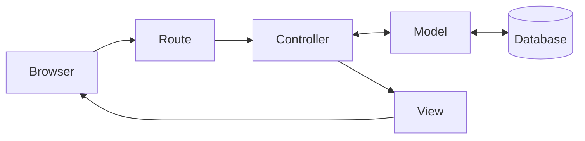

# What happened?

Inside the app

**Rails** is a **framework**: a set of tools that already solves what almost every website needs, so you can focus on what is unique to your project. `rails new` put together the whole structure of a website in seconds.

Of the many folders it created, three matter right now:

- **`app`**: the app's code. This is where you'll work most of the time.
- **`config`**: the settings, like the address of each page.
- **`db`**: everything about the database, where the messages will be stored.

The rest exists, works and can stay quiet for now.

The **server** is a program that waits for the browser to ask for a page and answers with it. While it's running, the terminal is busy with it. If the server shuts down, nobody can open the app.

The address of the tab that opened ends in `app.github.dev`: it's the address of your app inside the codespace. For now, only you can open it.

You are here: this is the path a request takes inside the app.

All the pieces of this path already exist in your app, but they're still empty. In the next chapters, you'll fill them in one by one. See what each word means in the [glossary]({{ site.baseurl }}).

There are no silly questions

Do I need to keep the server's terminal open?

Yes, as long as you want to see the app. To type other commands, open a new terminal with the terminal's **+** button.

So a website runs with a terminal open, running the server?

Not exactly. The websites you use every day live on a [server]({{ site.baseurl }}#server), a computer that stays on all the time. There, the server program starts on its own when the computer turns on and comes back if it crashes, with nobody keeping a terminal open. The codespace terminal is for when you're building the app: you start the server to test and stop it when you're done. In the chapter [How do we show the message board to the world?]({{ site.baseurl }}), you'll put your app on one of those servers.

Is this how a real application runs?

Almost. An app usually runs in at least two **environments**:

- **Development**: where you build and test, like in your codespace. Here, Rails shows details when something goes wrong and notices on its own when you change the code, so you see the result right away.
- **Production**: the version people actually use, on a server. Here, the app is set up to be faster and more secure, hides the details of errors and stores the real data.

The code is the same; what changes is the configuration. When you started the server, the terminal told you which environment it was in: `application starting in development`.

Does the codespace stay on forever?

No. It shuts down on its own after some time without use, but your files stay saved. See how to get back to it in [Stuck?]({{ site.baseurl }}#stuck), at the end of Hands-on.

Are the files on my computer?

When you use a codespace, no: they're in the cloud. That's why you can continue from another computer: you just log in to your GitHub account.

Break it on purpose Optional

1. Click the terminal where the server is running and press **Ctrl+C**. The server shuts down and the terminal goes back to the place where you type.
2. Go back to the app's tab and reload the page.

**Make a guess:** what will show up?

Instead of the Rails page, an error page shows up: there's nobody on the other side to answer. Start the server again with `bin/rails server`, reload the tab and everything comes back.

Do I need AI for this chapter?

No. Everything here is done with clicks and a few commands (`ruby -v`, `rails -v`, `rails new .` and `bin/rails server`). An AI wouldn't make anything faster and could even get in the way: suggest commands for another system, create files you didn't ask for or skip exactly the steps that show how the app works.

The codespace has an AI chat panel on the right. If you want to use it, treat the AI as a tutor, not as someone who does it for you (see how to start the conversation in [Using AI as a tutor]({{ site.baseurl }})):

- **Ask for explanations.** For example: "What does the `rails new .` command do?" or "What does this error message mean?".
- **Ask it to guide you,** one step at a time, and do each step yourself.
- **Never run a command you don't understand.** If the AI suggests a command, ask what it does before running it.
- **Don't let the AI run commands or change files on its own.** You need to know what changed in your app, and why.

**AI and `rails new`**

`rails new` also generates code: dozens of files with a single command. But it is **predictable**: the same command always generates the same files, the way Rails recommends.

An AI also generates code, but each answer can come out different, and you need to check everything it did.

Knowing what Rails tools already do on their own keeps you from asking an AI for something a command solves faster and without surprises.

Remember

- A website needs files with code, a computer that runs that code and a server that delivers the pages.
- The **repository** holds the files; the **codespace** is the computer in the cloud where you work.
- `rails new` creates the whole structure of the app; for now, the folders that matter are `app`, `config` and `db`.
- The app only opens while the server is running.
- A **commit** saves how the project is right now; **Sync Changes** sends that record to GitHub.

Quiz

1. What happens to the app if you shut down the server?
2. Which folder will hold most of the app's code?
3. What's the difference between the repository and the codespace?

See the answers

1. It stops opening: the browser shows an error, because there's nobody to answer. Just start the server again with `bin/rails server`.
2. The `app` folder.
3. The repository is where the files are stored, on GitHub. The codespace is the computer in the cloud where you open those files, run commands and start the server.

Learn more

Videos from Rails Girls São Paulo 2025 (in Portuguese):

- [Introduction to Ruby](https://www.youtube.com/watch?v=hkSSRm8SQDU), with Isadora Silva.
- [Introduction to Ruby on Rails](https://www.youtube.com/watch?v=6vSvbInY0Bc), with Beatriz Mitre.

## What's next?

The app exists and it's saved on GitHub. Next challenge: [How do we store the messages?]({{ site.baseurl }})
