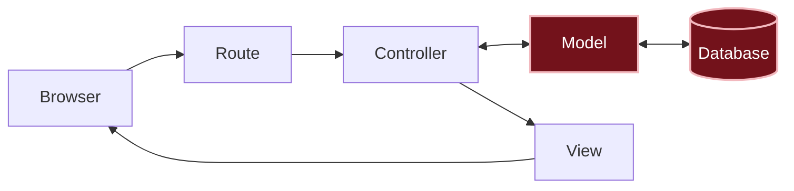

# What happened?

<details class="passo" markdown="1" open>
<summary>Inside the app</summary>

In this chapter, three pieces worked together:

- The `Message` **[model]({{ site.baseurl }}#model)** is the part of the app that takes care of the messages: it stores, looks up, counts and deletes them. It's what you talked to in the console, with `Message.create` and `Message.count`. If you open its file, `app/models/message.rb`, you'll see only two lines. Even so, it already knows how to store, look up, count and delete, because that code comes ready-made in Rails.
- The **[migration]({{ site.baseurl }}#migration)** is the instruction to create the table in the database. It only describes the change; what applies it is `bin/rails db:migrate`.
- The **[database]({{ site.baseurl }}#database)** is where the messages are really stored, to be used later. In the Message Board app, it's a **SQLite** database: a single file, `storage/development.sqlite3`, which Rails manages for you.

**Why do we need both the model and the migration?** Think of the messages spreadsheet:

| | Migration | Model |
|---|---|---|
| **In the spreadsheet** | Sets up the spreadsheet: creates the tab and names the columns | Is the specialist assistant who only takes care of this spreadsheet: writes rows, looks things up, counts and deletes |
| **When it works** | Once, when the structure changes | All the time, while the app is running |
| **In this chapter** | `bin/rails db:migrate` created the `messages` table | `Message.create` wrote Ana's message, and `Message.count` counted the messages |

They are different jobs: one prepares the place, the other works with what's inside it. If a message ever gets a new piece of information, it will need a new migration to create the column, and then the model starts using that column.

Rails connects the model to the table by name: the `Message` model, singular and capitalized, talks to the `messages` table, plural and lowercase. You didn't need to configure anything: it's a Rails **[convention]({{ site.baseurl }}#convention)**, an agreement about how to name things.

You are here: this is the path a request takes inside the app.



In this chapter, you built the two pieces highlighted in the diagram: the model and the table in the database. The browser doesn't reach them yet: that comes in the next chapters.

</details>

<details class="passo" markdown="1">
<summary>There are no silly questions</summary>

<details class="pergunta" markdown="1">
<summary>Why is the model called Message and the table, messages?</summary>

It's a Rails convention: the model represents **one** message, so it's singular; the table holds **many**, so it's plural. By following the convention, Rails connects the two on its own.

</details>

<details class="pergunta" markdown="1">
<summary>What if I run <code>bin/rails db:migrate</code> twice?</summary>

Nothing happens the second time. Rails writes down in the database itself which migrations have already run and only applies the ones that are still missing.

</details>

<details class="pergunta" markdown="1">
<summary>Why does the migration's name start with a date and time? <span class="label label-purple">Going further</span></summary>

The file name looks like `20261003120000_create_messages.rb`. The beginning is the date and time the migration was created: year, month, day, hour, minute and second (`2026-10-03 12:00:00`). This number has two jobs:

- **Putting the migrations in order.** Over the course of a project, the database changes many times: first it creates the table, then it adds a column, then another one. They always need to run in the order they were created, and the date and time make sure of that.
- **Not repeating numbers.** If the migrations were numbered 1, 2, 3…, two people working on the same project at the same time could create two migrations "number 4". With the date and time, that almost never happens.

Rails also uses this number to remember what has already run: it writes down in the database itself the number of each migration it applied. That's why running `bin/rails db:migrate` twice does nothing the second time.

</details>

<details class="pergunta" markdown="1">
<summary>Is the console the app?</summary>

It's the same app, but without the browser: instead of clicking buttons, you write Ruby code and see the answer right away. It's great for testing quick things, like you did with `Message.create`.

</details>

<details class="pergunta" markdown="1">
<summary>Where is Ana's message now?</summary>

In a row of the `messages` table, inside the file `storage/development.sqlite3`. This file doesn't go to GitHub (the Rails `.gitignore` leaves it out), so the message only exists in your codespace.

{: .atencao }
Don't delete or edit the `storage/development.sqlite3` file. It isn't a text file: opening and saving it in the editor can break the database, and deleting it makes all the messages disappear. To change the messages, use the console or, starting in the next chapters, the app itself.

</details>

<details class="pergunta" markdown="1">
<summary>Does every app store its data in a file like this? <span class="label label-purple">Going further</span></summary>

No. In many apps that are online, the database is a separate program, sometimes even on a computer of its own, like PostgreSQL or MySQL. For learning and for starting a project, SQLite works very well, and the way you use the model is practically the same in both cases.

</details>

</details>

<details class="passo" markdown="1">
<summary>Break it on purpose <span class="label label-opcional">Optional</span></summary>

Open the console again with `bin/rails console` and try to store a message with a piece of information that doesn't exist:

```ruby
Message.create(author: "Bia", title: "Hi")
```

**Make a guess:** what's going to happen?

The console shows an error similar to `unknown attribute 'title' for Message`. Read the message calmly: it says exactly what the problem is, `title` is not a piece of information a message has. The table only has the columns the migration created.

Now try to store a message **with nothing**:

```ruby
Message.create
```

**Make a guess:** will there be an error?

There isn't! To see what was stored, ask for the last message:

```ruby
Message.last
```

The console shows something like this:

```
#<Message:0x... id: 2, author: nil, content: nil, created_at: "2026-10-03 12:10:00", updated_at: "2026-10-03 12:10:00">
```

[`nil`]({{ site.baseurl }}#nil) means "nothing": the message has a number and a date, but no author and no text. Rails stored an empty message, because nobody told it that's not allowed. Keep this in mind: it's the topic of the chapter [What if someone sends an empty message?]({{ site.baseurl }}).

To delete this empty message, type:

```ruby
Message.last.destroy
```

Then leave the console with `exit`.

</details>

<details class="passo" markdown="1">
<summary>Do I need AI for this chapter?</summary>

No. `bin/rails generate model` already writes the model and the migration for you, always the same way, following the Rails conventions.

If you want to use an AI, use it to understand, not to do the work:

- Ask it to explain the migration line by line.
- If it suggests code that's different from what `generate` created, compare it with your plan. It's common for an AI to add things you didn't ask for, like extra information in the message. They might even be good ideas, but they're not part of this stage of the MVP. Remember: in an [MVP]({{ site.baseurl }}#how-projects-grow), we want to build the minimum for the message board to already work and be useful, and only then add the rest, one stage at a time. Focusing on the minimum helps you spend time only on what makes a difference to the people who will use it: the app is ready sooner, people can already use it, and you find out with them what is worth doing next.

</details>

<details class="passo" markdown="1">
<summary>Remember</summary>

- A **model** represents a piece of information in the app, like the message, and talks to the database.
- A **migration** describes a change to the database; `bin/rails db:migrate` applies the change.
- The `Message` model (singular) uses the `messages` table (plural): it's a Rails convention.
- In the code, `Message` is the message, `author` is the author and `content` is the text of the message.
- Rails creates the `id`, `created_at` and `updated_at` columns on its own.
- What's in the database stays there even after you close the console or the browser.

</details>

<details class="passo" markdown="1">
<summary>Quiz</summary>

1. What's the difference between the model and the migration?
2. You created the migration, but forgot to run `bin/rails db:migrate`. What happens when you try to use `Message` in the console?
3. Why was Ana's message still there after you closed the console?

<details markdown="1">
<summary>See the answers</summary>

1. The migration is the instruction to create or change the table in the database. The model is what uses that table inside the app, to store and look up messages.
2. The console complains that the table doesn't exist (`no such table: messages`), because the instruction hasn't been applied yet.
3. Because the message was stored in the database, not in the console. The console is just a way of talking to the app.

</details>

</details>

<details class="passo" markdown="1">
<summary>Learn more</summary>

Official Rails guides:

- [Active Record Basics](https://guides.rubyonrails.org/active_record_basics.html): how models work.
- [Active Record Migrations](https://guides.rubyonrails.org/active_record_migrations.html): everything about migrations.
- [The Rails Command Line](https://guides.rubyonrails.org/command_line.html): the `bin/rails` commands, like `generate` and `console`.

</details>

## What's next?

The messages are already stored, but they don't show up in the browser yet. Next challenge: [How do we see all the messages?]({{ site.baseurl }})
