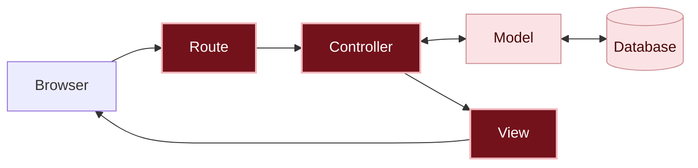

# What happened?

<details class="passo" markdown="1" open>
<summary>Inside the app</summary>

When someone opens the app, the request goes through three pieces from this chapter, in this order:

1. The **[route]({{ site.baseurl }}#route)**, in `config/routes.rb`, receives the address (`/messages` or the home page, `/`) and says: "this is for `MessagesController`, `index` action".
2. The **[controller]({{ site.baseurl }}#controller)**, in `app/controllers/messages_controller.rb`, asks the model for the messages (`Message.order(created_at: :desc)`) and keeps the list in `@messages`.
3. The **[view]({{ site.baseurl }}#view)**, in `app/views/messages/index.html.erb`, receives `@messages` and puts the page together, repeating the same part (the text and the author) for each message.

You are here: this is the path a request takes inside the app.



In dark red, the pieces from this chapter; in light pink, the ones you already know from previous chapters.

Now the path is complete: the request leaves the browser, goes through the route, the controller, the model and the database, and comes back as a page put together by the view.

#### The model, again

In the previous chapter, you saw that the `Message` model takes care of the messages stored in the database (remember the comparison with an assistant who takes care of a "spreadsheet"?). Here, the controller made a request to the model: "all the messages, from newest to oldest". And the model looked them up in the database and handed over the list. In the view, each `message` in the list is one message, with all its information: that's why you can write `message.content` and `message.author`.

#### Why keep the view separate from the model?

The model takes care of the data and the rules: what information a message has and how to store, look up and delete it. The view takes care only of how things look: how the message shows up on the screen. Keeping the two separate:

- **You can change how it looks without touching the data.** Changing how the messages look doesn't change anything in the model or in the stored messages.
- **The same data and the same rules work for different screens.** A rule written once in the model, like "every message needs an author", applies to every view that shows or receives messages.
- **Each file stays small and easy to find.** A problem with how it looks? Look at the view. A problem with the data? Look at the model.

And the controller sits in the middle, bringing the two together. Splitting the app like this makes everything easier to organize, and this split isn't something Rails invented: many other [frameworks]({{ site.baseurl }}#framework), in other languages, follow the same idea. By learning it here, you'll recognize this organization in other places.

#### Generators help, but you review

`bin/rails generate controller` created the controller and the view at once, but it also added a route we didn't want, and you deleted it. Generators (and AIs) save typing, but you are the one who decides what stays in the code.

Removing what isn't needed is a programmer's habit. Every extra line of code is one more thing to read, understand and keep working, and smaller code is easier to change later. This idea even has a name: **KISS**, from *keep it simple*. In the message board, the leftover route didn't break anything, but it left an extra address that nobody used.

#### The names fit together

You didn't need to tell Rails where each file is: it finds them by their names. The route `messages#index` leads to `MessagesController`, `index` action, which shows the view `app/views/messages/index.html.erb`. It's another Rails convention.

#### Following the errors

Each error in this chapter said exactly what was missing, in the same order as the request's path: first there was no route for `/messages`; then the route existed, but the controller didn't. Programmers spend a lot of time reading error messages, and that doesn't mean something went wrong: it means the next step is written on the screen.

</details>

<details class="passo" markdown="1">
<summary>There are no silly questions</summary>

<details class="pergunta" markdown="1">
<summary>Why did we delete the route that generate created?</summary>

The generator doesn't know you had already created the route in step 3, so it added its own, `get "messages/index"`. It would work, but it would leave two addresses for the same page, one of them with a strange name (`/messages/index`). Keeping a single route, the one you chose, makes the app simpler.

</details>

<details class="pergunta" markdown="1">
<summary>What is the @ in front of @messages?</summary>

It's how the controller passes a piece of information to the view. A variable with `@` in the controller can be used in the view. Without the `@`, it would only exist inside the controller, and the view wouldn't see it.

</details>

<details class="pergunta" markdown="1">
<summary>Why is the controller MessagesController, plural, and the model Message, singular?</summary>

The model represents **one** message. The controller takes care of **all** the messages: listing, posting, fixing and deleting. That's why the Rails [convention]({{ site.baseurl }}#convention) is a singular model and a plural controller.

And it's by following this convention that Rails finds everything on its own: the route `messages#index` leads to `MessagesController`, which lives in the file `app/controllers/messages_controller.rb` and shows the views in the `app/views/messages` folder. You didn't need to say where each file is. With a different name, like `MessageController`, Rails wouldn't find the controller, and an error would show up.

</details>

<details class="pergunta" markdown="1">
<summary>What is the .html.erb in the view's name? <span class="label label-purple">Going further</span></summary>

It means the file is an HTML page (`.html`) with bits of Ruby mixed in, which ERB (`.erb`, from *Embedded Ruby*) runs before sending the page to the browser.

</details>

<details class="pergunta" markdown="1">
<summary>What does each do? <span class="label label-purple">Going further</span></summary>

It repeats a piece of code for each item in a list. With two messages, the part with the text and the author shows up twice; with ten, ten times. You only write that part once.

</details>

<details class="pergunta" markdown="1">
<summary>Why sort by created_at, and not by updated_at? <span class="label label-purple">Going further</span></summary>

Both columns store dates, but from different moments:

- `created_at` is when the message was **created**, and it never changes.
- `updated_at` is when the message was last **changed**, and it changes with every fix.

For now, messages can't be fixed yet, so the two dates are the same. But in chapter 05, when you can fix a message, sorting by `updated_at` would make an old message jump to the top just because someone fixed one letter, as if it were new. With `created_at`, each message stays in the place of when it was posted.

Sorting by `updated_at` can also make sense in other apps, for example to show first what changed recently. It's a decision for whoever plans the app.

</details>

<details class="pergunta" markdown="1">
<summary>Where did the Rails welcome page go? <span class="label label-purple">Going further</span></summary>

It only shows up while the app doesn't have a home page. When you created the `root` route, the address `/` started showing the message board.

The welcome page wasn't deleted: it isn't even in your app's files. It comes from inside Rails itself, which only shows it when the home page is missing. If you delete the `root` line, it shows up again.

</details>

</details>

<details class="passo" markdown="1">
<summary>Break it on purpose <span class="label label-opcional">Optional</span></summary>

This test needs at least one message on the message board. Since you deleted all of them in step 8, create one from the console (`bin/rails console`):

```ruby
Message.create(author: "Ana", content: "Hi!")
```

Leave the console with `exit`. Then open the view `app/views/messages/index.html.erb` and change `message.content` to `message.text`. Save and reload the page.

**Make a guess:** what's going to happen?

The error page **NoMethodError in Messages#index** shows up, with a message similar to `undefined method 'text'`. Read it calmly: Rails is saying the message doesn't have any piece of information called `text`. It only knows the columns the migration created: `author` and `content`.

Before breaking something else, undo that change: change `message.text` back to `message.content`, save and reload. The message shows up again.

Now remove the `@` from `@messages` in the view (so it's just `messages.each`). Save and reload.

**Make a guess:** and now, what's going to happen?

The error page **NameError in Messages#index** shows up, with a message saying that `messages` doesn't exist (`undefined local variable or method`). Without the `@`, the view doesn't see the list the controller prepared.

Undo that change too: go back to `@messages`, save and reload. The message board shows up again.

Finally, remove the `=` from `<%= message.content %>` (so it's `<% message.content %>`). Save and reload.

**Make a guess:** will an error show up?

No error at all! The author is still on the page, but the text disappears. Without the `=`, Ruby still reads the message's text, but doesn't put the result on the page. This kind of problem is sneaky: nothing warns you that something is wrong, and you only notice by looking carefully at the page.

Put the `=` back (so it's `<%= message.content %>`), save and reload: the text shows up again.

</details>

<details class="passo" markdown="1">
<summary>Do I need AI for this chapter?</summary>

No. There are three small files, and Rails's own errors show the way.

Where an AI can help, if you want: explaining an error message you didn't understand. Paste the message and ask for an explanation, without asking for the ready-made fix. See how in [Using AI as a tutor]({{ site.baseurl }}).

Careful: if you ask an AI to "make the list of messages", it often suggests the *scaffold*, a generator that creates the model, controller, views and routes all at once. In this project, we only use small generators, like `generate controller`, and review each piece, to see how they connect.

</details>

<details class="passo" markdown="1">
<summary>Remember</summary>

- When someone opens the app, the request goes through the **route**, the **controller** and the **view**, in that order.
- The **route** says which controller takes care of each address.
- The **controller** asks the **model** for the messages and hands them to the view.
- The **view** puts together the page that shows up in the browser.
- An error message is a clue: it usually says exactly what's missing.

</details>

<details class="passo" markdown="1">
<summary>Quiz</summary>

1. When someone opens the message board in the browser, which pieces of the app does the request go through, and in what order?
2. You want to change the way the messages show up on the page. Which piece do you change: the route, the controller or the view?
3. You opened a new address and the error `No route matches` showed up. What's missing?

<details markdown="1">
<summary>See the answers</summary>

1. First the route, then the controller, which asks the model for the messages (and the model looks them up in the database), and finally the view, which puts the page together.
2. The view: it's what puts the page together.
3. The route: no route says where that address goes.

</details>

</details>

<details class="passo" markdown="1">
<summary>Learn more</summary>

Official Rails guides:

- [Rails Routing from the Outside In](https://guides.rubyonrails.org/routing.html): everything about routes.
- [Action Controller Overview](https://guides.rubyonrails.org/action_controller_overview.html): how controllers work.
- [Layouts and Rendering in Rails](https://guides.rubyonrails.org/layouts_and_rendering.html): how views are put together.

</details>

## What's next?

The message board already shows the messages, but they can still only be created from the console. Next challenge: [How do we post a message?]({{ site.baseurl }})
