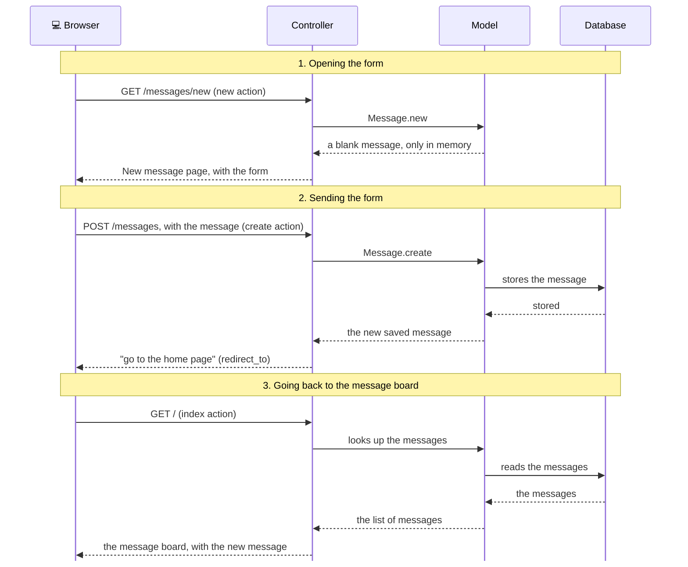

# What happened?

<details class="passo" markdown="1" open>
<summary>Inside the app</summary>

Posting a message uses **three** requests, one after the other:

1. **Opening the form.** When the person clicks **New message**, the browser makes a `GET /messages/new` request. The route sends it to the `new` action, which prepares a blank message, and the view `new.html.erb` shows the form.
2. **Sending the form.** When the person clicks **Post message**, the browser makes a `POST /messages` request, carrying what was written. The route sends it to the `create` action, which asks the model to store the message in the database.
3. **Going back to the message board.** `create` doesn't put any page together: it answers "go to the home page" (`redirect_to root_path`). The browser then makes a `GET /` request, and the `index` action, which you created in the previous chapter, shows the message board, already with the new message.



In each request, the route chooses the controller's action, as you saw in the previous chapter.

#### The form and the blank message

The view `new.html.erb` builds the form from the blank message the `new` action prepared (`@message = Message.new`). That's why the fields are called `author` and `content`, the same as the table's columns: the form knows what information a message has.

#### What travels from the browser to the controller

When the form is sent, what the person wrote reaches the controller in a package called `params` (from *parameters*). You can see this package in the server's terminal, in a line similar to this one:

```
Parameters: {"authenticity_token" => "[FILTERED]", "message" => {"author" => "Ana", "content" => "My first message!"}}
```

Notice the `"message" => {...}`: the author and the text arrive together, inside a message (`message`).

#### The list of what gets in

`message_params` doesn't take everything that arrived: it says exactly what the controller accepts, a message with `author` and `content`. If anything else arrives, it's ignored. This protects the app: someone could send a modified form trying to change a piece of information they shouldn't.

#### resources and the convention

`resources :messages` created the routes following the Rails [convention]({{ site.baseurl }}#convention): `GET /messages` goes to `index`, `GET /messages/new` goes to `new`, and `POST /messages` goes to `create`. `index` and `create` use the same address; what changes is the kind of request. With `only`, the app only has the routes you use.

The convention also gives names to the addresses: that's where the `new_message_path` in the **New message** link comes from. That's why the link only worked once the route existed.

</details>

<details class="passo" markdown="1">
<summary>There are no silly questions</summary>

<details class="pergunta" markdown="1">
<summary>What's the difference between Message.new and Message.create?</summary>

`Message.new` creates a message only in the app's memory, without storing it: it's there so the form knows what to fill in. `Message.create` creates it and stores it in the database right away. If the app were shut down, the message from `new` would disappear, and the one from `create` would still be there.

</details>

<details class="pergunta" markdown="1">
<summary>What's the difference between GET and POST?</summary>

`GET` **asks for** a page, without changing anything in the app: it's what happens when you open an address. `POST` **sends** information for the app to store or change something: it's what happens when you send a form. That's why the same address, `/messages`, can go to two different actions.

</details>

<details class="pergunta" markdown="1">
<summary>Why does create send the browser back, instead of showing the page directly? <span class="label label-purple">Going further</span></summary>

If `create` showed the message board directly, the browser's last request would still be the `POST`. Then, when reloading the page, the browser would send the form again, and the same message would be posted twice. With `redirect_to`, the last request is a `GET`, and reloading just shows the message board again.

</details>

<details class="pergunta" markdown="1">
<summary>What is the authenticity_token? <span class="label label-purple">Going further</span></summary>

It's a secret code that `form_with` hides in every form. When the form arrives, Rails checks this code to make sure the form came from the app itself, and not from another website trying to send messages in your name. In the terminal, it shows up as `[FILTERED]` (hidden), precisely because it's secret.

</details>

<details class="pergunta" markdown="1">
<summary>Why is there a private in the controller?</summary>

Everything that comes after `private` can only be used by the controller itself. That way, `message_params` doesn't become an action, and nobody can call it through an address. The actions, like `index`, `new` and `create`, always go before `private`.

</details>

</details>

<details class="passo" markdown="1">
<summary>Break it on purpose <span class="label label-opcional">Optional</span></summary>

In the controller, put a `#` in front of the line `@message = Message.new`, so it becomes a comment. Save and open the **New message** page.

**Make a guess:** what's going to happen?

The error page **ArgumentError in Messages#new** shows up, with the message `Passed nil to the :model argument, expect an object or false`. `form_with` got "nothing" (`nil`) instead of the blank message and doesn't know how to build the form.

Remove the `#`, save and reload: the form is back.

Now put a `#` in front of the line `redirect_to root_path`, in the `create` action. Save, reload the **New message** page and post a message.

**Make a guess:** will the message show up?

It looks like nothing happened: the page doesn't change, and the text is still in the form. But click **Back**: the message is there! It was stored, but `create` didn't send the browser back to the message board. This is another kind of problem with no error message: the app only half works.

Remove the `#`, save, and delete the test message from the console (`Message.last.destroy`).

</details>

<details class="passo" markdown="1">
<summary>Do I need AI for this chapter?</summary>

No. The form, the route and the actions follow the same path as the previous chapters, and the errors show each missing piece.

If you want to use an AI, use it as a tutor: ask it to explain, and do each step yourself. For example:

> What's the difference between a GET request and a POST request? Explain it with an everyday example, without giving me code.
{: .pedido-ia }

See how to start the conversation in [Using AI as a tutor]({{ site.baseurl }}).

<details class="pergunta" markdown="1">
<summary>What if I asked the AI for the code? <span class="label label-purple">Going further</span></summary>

If you ask an AI to "make a form to post messages", it often suggests the *scaffold*, which creates all the pages and actions at once, including the ones the plan doesn't ask for. That's why the request works better with the plan:

> In my Rails app, the `Message` model has `author` and `content`. I want a "New message" page (the `new` action), with the fields "Your name" and "Message" and the "Post message" button, and a "New message" link on the list page. After posting, it goes back to the list. No scaffold, and only the routes that are needed.
{: .pedido-ia }

Check the result against the plan:

- Does it have only what the plan asks for: the New message page and the link on the list, with no extra pages?
- Does the controller use a list of what it accepts (like `message_params`), and not `params` directly?
- Does the route have `only`, with only the actions you use?

See more tips in [Asking an AI for code]({{ site.baseurl }}), in the Extras.

</details>
</details>

<details class="passo" markdown="1">
<summary>Remember</summary>

- The `new` action prepares a blank message, and the view `new.html.erb` shows the form.
- A form sends what the person wrote with a `POST` request.
- The `create` action receives the form, asks the model to store the message and sends the browser back to the message board.
- The controller only accepts from the form what's on the `message_params` list.
- `resources` creates the routes following the Rails convention, and `only` chooses which ones.

</details>

<details class="passo" markdown="1">
<summary>Quiz</summary>

1. When the person clicks **Post message**, what kind of request does the browser make, and which action does it go to?
2. You created the route for `create`, but forgot to write the action in the controller. Where does the error show up, and what does it say?
3. Why did the **New message** link cause an error before you created the route?
4. After the message is stored, why does the person see the message board again?

<details markdown="1">
<summary>See the answers</summary>

1. A `POST /messages` request, which goes to the `create` action.
2. On the screen, nothing happens. In the server's terminal, `The action 'create' could not be found for MessagesController` shows up.
3. Because `new_message_path` is a name Rails creates from the routes. Without the route for `new`, that name didn't exist, and the **NameError** showed up.
4. Because the `create` action ends with `redirect_to root_path`, which sends the browser back to the home page.

</details>

</details>

<details class="passo" markdown="1">
<summary>Learn more</summary>

Official Rails guides:

- [Action View Form Helpers](https://guides.rubyonrails.org/form_helpers.html): everything about `form_with` and form fields.
- [CRUD, Verbs, and Actions](https://guides.rubyonrails.org/routing.html#crud-verbs-and-actions): how `resources` connects verbs, addresses and actions.
- [Strong Parameters](https://guides.rubyonrails.org/action_controller_overview.html#strong-parameters): the list of what the controller accepts.

</details>

## What's next?

Now anyone can post a message. But if they write something wrong, there's no way to fix it. Next challenge: [Oops! How do we fix or delete a message?]({{ site.baseurl }})
