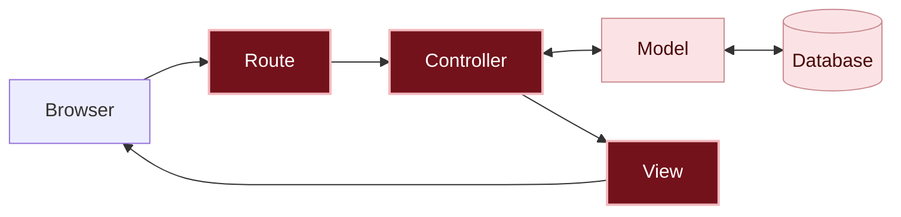

# What happened?

Inside the app

**Each message's number.** To fix or delete, the app needs to know **which** message. That's why the `id` goes in the address: in `/messages/3/edit`, the `3` is the message. In the action, `params[:id]` takes that number, and `Message.find` asks the model for the message with it.

**Fixing has two actions.** One **shows** the form and the other **stores** what came from it:

1. `edit` looks up the message and shows the form already filled in.
2. `update` receives the form, changes what changed and stores it in the database.

Posting, in chapter 04, has the same idea: `new` shows the empty form, and `create` stores the new message. They're two pairs that go together: `new` and `create`, `edit` and `update`.

**Every request has a kind.** The browser doesn't send just the address: it also says **what it wants to do** with it. This kind of request is called an **HTTP verb**:

| What the person does | Verb | Address | Action |
|---|---|---|---|
| Sees the message board | `GET` | `/` or `/messages` | `index` |
| Opens the new message page | `GET` | `/messages/new` | `new` |
| Posts a message | `POST` | `/messages` | `create` |
| Opens the edit page | `GET` | `/messages/3/edit` | `edit` |
| Saves the fix | `PATCH` | `/messages/3` | `update` |
| Deletes a message | `DELETE` | `/messages/3` | `destroy` |

Notice: saving and deleting use the **same address**, `/messages/3`. What changes is the verb. That's how the route knows which action to send it to.

You are here: this is the path a request takes inside the app.

In dark red, the pieces from this chapter; in light pink, the ones you already know from previous chapters.

**The model, again.** The `Message` model is still taking care of the messages stored in the database (the "spreadsheet" assistant, remember?). In this chapter, the controller asked the model: "bring me message number 3" (`find`), "change what's written on it" (`update`) and "delete this message from the database" (`destroy`).

**CRUD is complete.** With this chapter, the message board does the four [CRUD]({{ site.baseurl }}#crud) actions: create (post), read (see), update (fix) and delete. Almost every system that stores information does these four things, and now you know how they work on the inside.

There are no silly questions

Why does the message's number show up in the address?

Because each request reaches the app on its own: when you click **Save**, the app doesn't remember which message you opened before. The number in the address says, in every request, which message it's about.

When a message is deleted, does its number get used again?

No. If message 3 is deleted, the next message will be 4, 5 or whatever comes next, never 3 again. That way, an old link to `/messages/3/edit` never opens someone else's message by mistake: it gives the error `Couldn't find Message`.

Why does the message in edit have an @ and the one in destroy doesn't?

The `@` is for passing a piece of information from the controller to the view. `edit` shows a view with the form, so it needs `@message`. `destroy` doesn't show any view: it deletes the message and sends the browser back to the home page.

`update` uses `@message` too. For now, it wouldn't make a difference, but in chapter 07 it will need to show the form again when the message is empty.

Why is Edit a link and Delete a button?

**Edit** only opens a page, without changing anything: a link (`GET`) is enough. **Delete** changes the database, and changes are made with forms and buttons (`DELETE`). That way, a program that visits the links on a page, like a search engine, never deletes anything by accident.

What if I take the only out of the route?

Without `only`, `resources :messages` creates routes for all seven Rails actions, including one the message board doesn't use: `show`, the page for a single message. See the list in the [glossary]({{ site.baseurl }}#action). With `only`, the app only has the routes you need.

I copied the form. Is there a way not to repeat it? Going further

There is: Rails lets you split a piece of a view into a file of its own, called a *partial*, and use that piece in several views. `new.html.erb` and `edit.html.erb` are a great example: both have the same form, and only the heading and the button change. We chose to copy it to keep each view complete and easy to read. In the chapter [What if someone sends an empty message?]({{ site.baseurl }}), step 9 shows how to bring the two forms together in a partial. To learn more, see *partials* in the guide [Layouts and Rendering in Rails](https://guides.rubyonrails.org/layouts_and_rendering.html#using-partials).

Break it on purpose Optional

Click **Edit** on a message. In the address bar, replace the message's number with `999` (or another number that doesn't belong to any message), so the address ends with `/messages/999/edit`, and press **Enter**.

**Make a guess:** what's going to happen?

The **ActiveRecord::RecordNotFound** page shows up, with the message `Couldn't find Message with 'id'="999"`. The route and the action exist, but the model didn't find any message with that number.

Now take `:destroy` off the `only` list, in `config/routes.rb`, save and reload the home page. The **Delete** button is still there.

**Make a guess:** click **Delete** on a message and then **OK**. What happens?

On the screen, nothing happens: the message is still there. In the server's terminal, `No route matches [DELETE] "/messages/3"` shows up. The button exists and sends the request, but no route takes the `DELETE` verb for that address. Notice: the address `/messages/3` still exists, for the `PATCH` of `update`. What's missing is the route to **delete**.

Put `:destroy` back, save and reload: the message board is back to normal.

Do I need AI for this chapter?

No. You repeated the same path as chapter 04, link, route, controller and view, and the errors showed each missing piece.

If you want to use an AI, use it as a tutor: ask it to explain, and do each step yourself. For example:

> Why, in Rails, is deleting something done with a button, and not with a link? Explain it without giving me code.
{: .pedido-ia }

See how to start the conversation in [Using AI as a tutor]({{ site.baseurl }}).

What if I asked the AI for the code? Going further

If you ask an AI to "make the edit and delete", it will very likely suggest the *scaffold*, or create all seven actions at once, including pages the message board doesn't use. That's why the request works better with your plan:

> In my Rails app, the `Message` model has `author` and `content`. I want an **Edit** link on each card, which opens a page with the form filled in, and a **Delete** button that asks "Do you really want to delete this message?" before deleting. No scaffold, and only the routes that are needed.
{: .pedido-ia }

Even with a good request, check the result against the plan:

- Does the route have `only`, with only the actions you use?
- Does **Delete** ask before deleting?
- Does the controller use `message_params`, and not `params` directly?

See more tips in [Asking an AI for code]({{ site.baseurl }}), in the Extras.

Remember

- Each message has an `id`, a number of its own. The address carries that number, and `params[:id]` takes it in the action.
- `Message.find` looks up a message by its number; `update` changes and stores it; `destroy` deletes it.
- Fixing has two actions: `edit` shows the form and `update` stores it.
- The request's verb (`GET`, `POST`, `PATCH`, `DELETE`) says what the browser wants to do with the address.
- Anything that deletes forever deserves a question first.

Quiz

1. In `/messages/7/edit`, what's the value of `params[:id]`?
2. Saving the fix and deleting use the same address, `/messages/7`. How does the route know which action to send it to?
3. You created the `edit` action, but forgot to create the view. Which error shows up?

See the answers

1. `7`.
2. By the request's verb: `PATCH` goes to `update`, and `DELETE` goes to `destroy`.
3. The **No view template for interactive request** page, saying the file `app/views/messages/edit.html.erb` is missing.

Learn more

Official Rails guides:

- [CRUD, Verbs, and Actions](https://guides.rubyonrails.org/routing.html#crud-verbs-and-actions): how `resources` connects verbs, addresses and actions.
- [Action View Form Helpers](https://guides.rubyonrails.org/form_helpers.html): everything about `form_with` and form fields.

## What's next?

The message board already does everything the plan asks for, but the cards are still just text, one below the other. Next challenge: [How do we make the message board look nicer?]({{ site.baseurl }})
