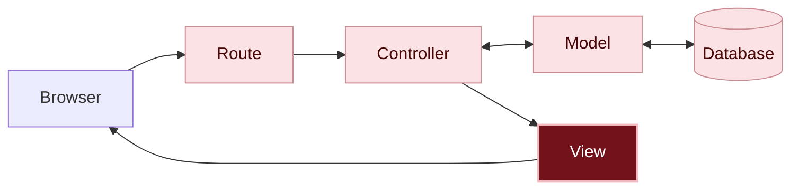

# What happened?

<details class="passo" markdown="1" open>
<summary>Inside the app</summary>

In this chapter, only how things look changed. You changed three kinds of files, all of them views:

1. The **layout**, `app/views/layouts/application.html.erb`, which is the frame for every page: it now brings in Bulma.
2. The app's views: the message board's, `index.html.erb`, and the forms', `new.html.erb` and `edit.html.erb`. They got classes, which tell Bulma what each part of the page is.

You are here: this is the path a request takes inside the app.



In dark red, the pieces from this chapter; in light pink, the ones you already know from previous chapters.

#### Ready-made styles

**Bulma** is a [CSS]({{ site.baseurl }}#css) library: a set of styles someone else already wrote and left ready to use. You didn't write any styles: you just gave names to the parts of the page, with classes, and Bulma already knew how to show a `button`, a `card` or a `box`.

#### The layout, the frame for every page

Each view only puts together the middle of the page. The rest, like the tab's title and the styles, comes from the layout, which wraps every view. That's why a single line in the layout was enough for Bulma to apply to the whole app.

#### The separation paid off

In [chapter 03]({{ site.baseurl }}), you saw that the view and the model are kept separate. In this chapter, you changed the whole look of the messages without touching the model, the controller or any stored message.

</details>

<details class="passo" markdown="1">
<summary>There are no silly questions</summary>

<details class="pergunta" markdown="1">
<summary>Do I need to memorize Bulma's classes?</summary>

No. Nobody memorizes them: programmers look things up in the [Bulma documentation](https://bulma.io/documentation/) whenever they need to. It has examples for each part, like buttons, cards and forms, ready to copy.

</details>

<details class="pergunta" markdown="1">
<summary>Does every app fetch its CSS from the internet, like Bulma here? <span class="label label-purple">Going further</span></summary>

No. Fetching the CSS from another website, with the `<link>` line, is the fastest way to get started: a single line, with nothing to install. That's why the guide uses it. But this way depends on the internet and on another website being online. That's also why the address has Bulma's version (`bulma@1.0.4`): that way, the app's look doesn't change on its own when a new version comes out.

In real apps, it's more common for the CSS to live **inside the app itself**, together with the rest of the code, in the `app/assets/stylesheets` folder. Rails already created a file there, `application.css`, which you'll use in the challenge [Message colors]({{ site.baseurl }}). That CSS can be written by hand, come from a library kept in the project or be built by a tool, like Tailwind. That way, the app works the same anywhere, and programmers decide when to update.

</details>

<details class="pergunta" markdown="1">
<summary>Isn't using a ready-made library cheating?</summary>

No. Almost every app uses code that other people wrote, and Rails itself is an example of that. Choosing a good tool and knowing how to use it is part of a programmer's job. Learning to write CSS from scratch is still useful, and you can do that at your own pace after the workshop.

</details>

<details class="pergunta" markdown="1">
<summary>Can I change the colors and the look of the buttons? <span class="label label-purple">Going further</span></summary>

You can. Replace the `is-primary` on the **Post message** button with `is-link`, `is-info`, `is-success` or `is-warning`, save and reload to see the difference. The Bulma documentation shows all the options on the [buttons](https://bulma.io/documentation/elements/button/) page.

</details>

<details class="pergunta" markdown="1">
<summary>Does Bulma come from the internet? <span class="label label-purple">Going further</span></summary>

It does. The `<link>` line fetches Bulma's styles from a website on the internet, and that's why you didn't need to install anything. Without internet, the app keeps working, but without the styles.

</details>

</details>

<details class="passo" markdown="1">
<summary>Break it on purpose <span class="label label-opcional">Optional</span></summary>

In `app/views/layouts/application.html.erb`, put `<!--` before and `-->` after the Bulma line, so it becomes a comment:

```erb
    <!-- <link rel="stylesheet" href="https://cdn.jsdelivr.net/npm/bulma@1.0.4/css/bulma.min.css"> -->
```

Save and reload the page.

**Make a guess:** what happens to the message board?

It goes back to being just text, one message below the other. No error shows up: the classes are still there, but nobody tells the browser what to do with them.

Remove the `<!--` and the `-->`, save and reload: the message board looks nice again.

</details>

<details class="passo" markdown="1">
<summary>Do I need AI for this chapter?</summary>

No. Bulma already comes with ready-made classes, and the [Bulma documentation](https://bulma.io/documentation/) shows what each one does.

If you want to use an AI, use it as a tutor: ask it to explain, and do each step yourself. For example:

> In Bulma, what do the `columns` and `column` classes do? Explain it with an example, without changing my code.
{: .pedido-ia }

See how to start the conversation in [Using AI as a tutor]({{ site.baseurl }}).

<details class="pergunta" markdown="1">
<summary>What if I asked the AI for the code? <span class="label label-purple">Going further</span></summary>

To make the look your own, an AI can help you find the right classes. The request works better with your plan:

> In my Rails app, I already use Bulma 1.0, with a `<link>` line in the layout. Each message shows up in a `card` inside `columns is-multiline`. How do I make the message board's heading bigger and a different color, using only Bulma classes?
{: .pedido-ia }

Check the result:

- Does it use Bulma classes, or did it suggest another library, like Bootstrap or Tailwind? They have different class names and don't work together with Bulma.
- Did it ask you to install something? With the `<link>` line, you don't need to.
- Do the classes it suggested exist in the [Bulma documentation](https://bulma.io/documentation/)?

See more tips in [Asking an AI for code]({{ site.baseurl }}), in the Extras.

</details>
</details>

<details class="passo" markdown="1">
<summary>Remember</summary>

- Bulma is a set of ready-made styles: you give names to the parts of the page, with classes, and it takes care of how they look.
- The layout is the frame for every page: whatever goes in it applies to the whole app.
- In this chapter, only the view changed. No stored message changed.

</details>

<details class="passo" markdown="1">
<summary>Quiz</summary>

1. You want the **Post message** button to be blue. Which file do you change?
2. Why was a single line in the layout enough for Bulma to apply to the New message and Edit message pages too?
3. In this chapter, did any message stored in the database change?

<details markdown="1">
<summary>See the answers</summary>

1. `app/views/messages/new.html.erb`, changing the button's class, for example from `is-primary` to `is-link`.
2. Because the layout wraps every view in the app.
3. No. Only how things look changed.

</details>

</details>

<details class="passo" markdown="1">
<summary>Learn more</summary>

- [Bulma documentation](https://bulma.io/documentation/): every class, with examples.
- [CSS](https://developer.mozilla.org/en-US/docs/Web/CSS), on MDN: for anyone who wants to learn to write styles from scratch.

</details>

## What's next?

The message board looks nice, but it still accepts anything: even a message with no text. Next challenge: [What if someone sends an empty message?]({{ site.baseurl }})

Finished early and want more? In the extra challenge [Message colors]({{ site.baseurl }}), each person chooses the color of their sticky note.
