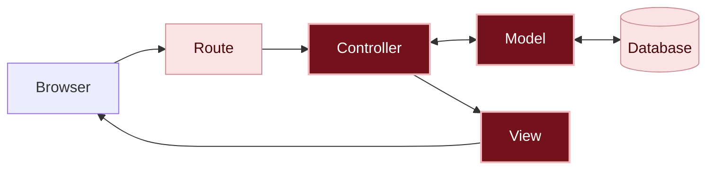

# What happened?

Inside the app

When someone clicks **Post message**, the path now has a question in the middle:

1. The controller builds the message with what came from the form (`Message.new`).
2. The model checks the rules (`save`). If everything is right, it stores the message in the database and answers `true`. If something is missing, it doesn't store anything, writes down what was missing in `errors` and answers `false`.
3. The controller decides what to do with the answer: if it worked, it goes back to the message board; if not, it shows the page again (`render`).
4. The view shows the form with what the person wrote and, below each field, the warning about what's missing.

You are here: this is the path a request takes inside the app.

In dark red, the pieces from this chapter; in light pink, the ones you already know from previous chapters.

#### The rules live in the model

The `Message` model is no longer just the place that stores and looks up messages: now it also knows **what a valid message is**. Since every message goes through the model before going to the database, the rule applies to everything: the posting form, the fix and even the console.

#### You are the one who decides

Rails had no way of knowing that an empty message is a problem: for it, an empty text is a text like any other. Deciding the rules (what's required, what the maximum size is, what happens when something is missing) is the programmer's job. That's why you thought about them in the plan, before writing code.

#### Redirect or render

Until now, after storing, the controller used `redirect_to`: it tells the browser to make a new request, and the page starts from scratch, with an empty form. Now, when the message is rejected, the controller uses `render`: it puts the page together right away, with the `@message` that was just rejected. That's why what the person wrote stays in the form, together with the warnings.

There are no silly questions

Why does the rule live in the model, and not in the view?

Because the form is only one of the ways to create a message. You can also create one from the console, from the fix and, in a bigger app, in other ways. With the rule in the model, every message goes through it, wherever it comes from.

It's the idea of **centralizing**: the rule is written in a single place. If it were in each form, you'd have to repeat the same rule in `new.html.erb`, in `edit.html.erb` and in any other new page, and forgetting one would be enough for an empty message to get through. With the rule in the model, changing the limit from 280 to 200 characters means changing one line, and the change applies to the whole app.

What about the empty messages that were already stored?

The rules only apply to what gets stored from now on. An empty message stored before stays there, until someone deletes it. That's why, in step 2, you deleted the empty card.

Why 280 characters?

It's a decision for whoever plans the app: enough for a message, and short enough to fit on a card. The number 280 is just an example, based on the limit for a post on X (formerly Twitter), a size many people already know as a short message. Another app, or another group, could choose another number. What matters is that the rule exists and is written in a single place, the model.

What is unprocessable_entity? Going further

It's the name of a **status code**, a number the app sends along with each page to say how the request went. This one is 422, which means "I got the form, but I couldn't use what came in it". The browser uses this code to know it needs to show the page with the warnings, instead of moving on.

Why don't all the warnings show up together, above the form? Going further

They could, with `@message.errors.full_messages`, but Rails builds those sentences by joining the column's name with the warning: it would come out as `Author Write your name.`. By showing each warning below its field, the person sees only the sentence you wrote, and already knows where to fix it.

Break it on purpose Optional

In the `create` action, replace the line `render :new, status: :unprocessable_entity` with `redirect_to new_message_path`. Save, click **New message**, write only your name and click **Post message**.

**Make a guess:** what's going to happen?

The **New message** page comes back, but empty: your name is gone, and no warning shows up. `redirect_to` tells the browser to make a new request, and the `new` action prepares a blank message, with nothing you wrote and without the warnings. That's why, when the message is rejected, the controller uses `render`.

Change the line back to `render :new, status: :unprocessable_entity` and save.

Now, in the model, replace `presence: { message: "Write your name." }` with just `presence: true`. Save and post a message without a name.

**Make a guess:** what will the warning say?

`can't be blank` shows up: it's the warning Rails uses when you don't write your own.

Go back to `presence: { message: "Write your name." }`, save and post again: your own warning is back.

Do I need AI for this chapter?

No. The rules are a few lines in the model, and Rails itself keeps the warnings for each field.

If you want to use an AI, use it as a tutor: ask it to explain, and do each step yourself. For example:

> Why do the rules for a message live in the model, and not in the form? Explain it without giving me code.
{: .pedido-ia }

See how to start the conversation in [Using AI as a tutor]({{ site.baseurl }}).

What if I asked the AI for the code? Going further

This chapter is the best example of why you should think before asking.

If you ask an AI to "make a message board in Rails", the generated code may accept empty messages, like yours did until now, or it may come with rules the AI chose on its own, which might not be the ones you wanted. It depends on the tool and on the request. **You are the one who decides that an empty message is an error**, and the AI only knows that if you tell it.

With the plan, the request looks like this:

> In my Rails app, the `Message` model has `author` and `content`. I want these rules: `author` and `content` required, and `content` with at most 280 characters. The warnings should be: "Write your name.", "Write your message." and "The message can have at most 280 characters.". When the message is rejected, the form comes back with what the person wrote and with the warning below each field.
{: .pedido-ia }

Check the result against the plan:

- Are the three rules in the model?
- Is a message with only spaces rejected?
- Do the `create` action and the `update` action check whether it worked, with `if`?
- Does what the person wrote stay in the form when the message is rejected?

See more tips in [Asking an AI for code]({{ site.baseurl }}), in the Extras.

Remember

- The rules for the data live in the model, with `validates`, and apply to every message, wherever it comes from.
- `save` and `update` answer `true` if it worked and `false` if the message was rejected.
- When it works, the controller uses `redirect_to`; when the message is rejected, it uses `render`, which keeps what the person wrote.
- Rails doesn't know what a valid message is: the programmer decides.

Quiz

1. Someone tries to post a message with only the name. Is the message stored in the database?
2. Why does the name the person wrote stay in the form when the message is rejected?
3. You want the name to have at most 50 characters. Which file do you write this rule in?

See the answers

1. No. The model checks the rules before storing, and `save` answers `false`.
2. Because the controller uses `render`, which shows the page with the rejected `@message`, instead of `redirect_to`, which would start from scratch.
3. In the model, `app/models/message.rb`: `validates :author, length: { maximum: 50, message: "..." }`.

Learn more

Official Rails guide:

- [Active Record Validations](https://guides.rubyonrails.org/active_record_validations.html): all the rules Rails already comes with.

## What's next?

The message board is ready: it looks nice, and it only accepts real messages. But it only works inside your codespace. Next challenge, optional: [How do we show the message board to the world?]({{ site.baseurl }})

Stopping here for today? See how to shut everything down and come back another day in [All done! What's next?]({{ site.baseurl }}).
