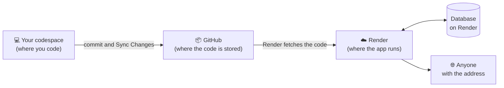

# 08. How do we show the message board to the world? Optional

Time: about 40 minutes, counting the wait for the first deploy.
{: .fs-5 }

{: .dica }
This chapter is **optional**. Your message board is already finished in chapter 07. Here, it goes on the internet, and for that you'll need a Render account and a few minutes of waiting. If the workshop time runs out, you can do it at home, at your own pace, following the guide.

## The challenge

The Message Board app is finished: you can post, see, fix and delete, the cards look nice and empty messages are rejected. But it only works inside your codespace. When you shut down the codespace, the app goes offline, and nobody can open it anymore.

The challenge now is to **put the message board online**: an address on the internet that anyone can open, from their phone or computer, and leave a message.

## Think before you code

Set aside about 5 minutes. There is no wrong answer.

- Right now, where does the app run? What happens to it when you close the codespace?
- For the app to be online all the time, it needs to run on some computer that's on all the time. Whose computer would that be?
- Do the messages you posted in your codespace go along to the online app? Why?
- Who can post on the online message board? What could go wrong when anyone can open your app?

## Compare with our plan

Open our plan

The app is going to run on **Render**, a service that hosts and runs apps on the internet. The code's path looks like this:

- **Where the app runs:** on a Render computer, which is on all the time, with an address like `https://message-board.onrender.com`.
- **Where the code comes from:** from your repository on GitHub, the same one that has been getting your commits since chapter 01. Every time you make a commit and a **Sync Changes**, Render updates the online app on its own.
- **The messages:** the online app has its own database, on Render. It starts empty: the test messages from your codespace stay only in the codespace.
- **The free plan:** the app stays online for free, with two conditions. If nobody opens the message board for about 15 minutes, it "goes to sleep", and the next person waits about a minute for it to wake up. And the free database lasts 30 days: after that, the online message board's messages are deleted.
- **The password:** so that bots don't fill the message board with spam, the app asks for a password before opening. People from the workshop get the password and get in.
- **The minimum:** an address that works. An address with a name of its own, like `board.yourname.com`, is left out.

## Hands-on

Now it's your turn: follow the steps in [Hands-on]({{ site.baseurl }}). When you're done, go on to [What happened?]({{ site.baseurl }}).

## What happened?

Finished the steps? In [What happened?]({{ site.baseurl }}) you understand each step, see whether you need AI and answer a quiz.
