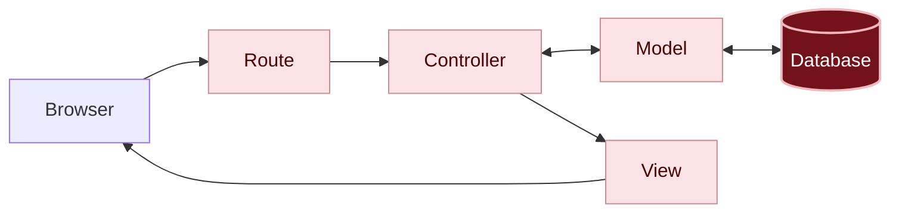

# What happened?

Inside the app

Now your app exists in two places:

| | In your codespace | On Render |
|---|---|---|
| **What for** | Coding and testing | For anyone to use |
| **Who opens it** | Only you | Anyone with the address and the password |
| **Database** | SQLite, a file (`storage/development.sqlite3`) | PostgreSQL, a separate service |
| **The messages** | Your tests | The real messages |

Programmers call the first one the **development** environment and the second one the **production** environment. The code is the same, and what changes between the two lives in separate settings.

You didn't need to choose the environment: what tells Rails which environment it's in is the environment variable `RAILS_ENV`. Render creates this variable on its own, with the value `production`, in every Ruby app. In the codespace, it doesn't exist, and Rails uses `development`.

Each environment has its own settings file, in the `config/environments` folder: `development.rb` and `production.rb`, which `rails new` already created. You changed one of them in chapter 04: the form protection line went into `development.rb`, and that's why it only applies in the codespace. And the production database comes from the `DATABASE_URL` variable, which you pasted into Render.

You are here: this is the path a request takes inside the app. It's the same in the codespace and on Render: what changed is the computer where the app runs.

In dark red, the piece that changed in this chapter; in light pink, the ones you already know from previous chapters.

#### The deploy

**Deploy** is the name of the process of taking the code to the place where the app runs and starting the app again. Every Render deploy follows the same recipe: fetch the code from GitHub, run the **Build Command** recipe and start the app with `bin/rails server`. Since it follows your repository, every **Sync Changes** becomes a new deploy.

#### Secrets stay out of the code

`DATABASE_URL` (with the database's password), `RAILS_MASTER_KEY` (the app's secret key) and `ACCESS_PASSWORD` (the message board's password) are not in your code or on GitHub: they were pasted straight into Render, as **environment variables**. That way, even if someone sees your repository, they can't get into your database.

{: .atencao }
Never write a secret in the code or commit a file with secrets, even if the repository is private. Everything that goes to GitHub is kept in the commit history: deleting the secret in a later commit doesn't remove it from the earlier commits. If a secret ends up on GitHub, consider it leaked and replace it with a new one. That's why Rails already leaves `config/master.key` out of the commits.

#### Your commits tell the story

Since chapter 01, you've been saving your progress with commits and sending them to GitHub. That's what let Render fetch the finished app. The commit history is also the story of your message board, chapter by chapter.

There are no silly questions

Why did the online app start without my messages?

Because each place has its own database. The codespace's database is a file that doesn't go to GitHub, and Render only gets what's on GitHub. The test messages stay in the codespace, and the online message board starts from scratch, ready for the real messages.

Will my message board stay online forever?

On Render's free plan, the database lasts 30 days: after that, it's deleted, and the online message board loses its messages. The app stays online, but without a database it stops working. To keep it longer, you can pay for a Render plan or use another service. If you're not going to keep it, delete the app and the database on Render when you no longer need them: chapter 09 shows how. The code stays safe on your GitHub.

Can anyone delete the messages on my board?

Anyone who has the password, yes. The password keeps out the bots and anyone who finds the link by chance, but everyone uses the same one, so the app doesn't know who is who. That's the decision we made back in the [planning]({{ site.baseurl }}): for a workshop message board, accepting that risk is reasonable. In a real app, open to anyone, it would be worth having accounts and rules about who can do what. That's for a future project.

Why Render, and not another service? Going further

Render has a free plan that works with Rails apps without needing to set up a server, and that doesn't ask for a credit card to create the account, the app and the database. There are many other services for putting apps online, each with its own advantages, and Rails itself comes with a tool for that, [Kamal](https://kamal-deploy.org/), which puts the app online on a server of your own (see also [Deploying to Production](https://guides.rubyonrails.org/getting_started.html#deploying-to-production), in the official Rails guide). What you learned here applies to almost all of them: the code comes from GitHub, the secrets live in environment variables, and the production database is separate from the development one.

Can I use an address of my own, like <code>board.mysite.com</code>? Going further

You can. That address of your own is called a **custom domain**. The path is this:

1. **Get a domain.** It's bought from a domain registrar. Registration is paid yearly.
2. **Tell Render.** On the app's page, under **Settings**, look for **Custom Domains** and add the address, for example `board.mysite.com`.
3. **Point the domain to Render.** At the registrar where the domain was registered, create the **DNS** record Render shows you (usually a `CNAME` pointing to the app's `.onrender.com` address). DNS is the internet's "phone book": it says which computer each address leads to.
4. **Verify.** Back on Render, click **Verify**. The DNS change can take from a few minutes to a few hours to take effect.

It works on Render's free plan: the only cost is registering the domain. Render also takes care of **HTTPS** (the browser's padlock) for your domain on its own. See the details in [Custom Domains](https://render.com/docs/custom-domains), in the Render documentation.

Do I need AI for this chapter?

No. The steps are clicks on Render and two small changes to the code.

Where an AI can help: understanding an error message from the deploy. Copy the last lines of the messages and ask for an explanation, like in [Using AI as a tutor]({{ site.baseurl }}).

{: .atencao }
Never paste the `DATABASE_URL` or the contents of `config/master.key` into an AI, or anywhere else. Before pasting an error message, check that it doesn't contain either of them.

Remember

- The same app runs in two places: in the codespace, for coding (development), and on Render, for people to use (production).
- Each place has its own database.
- Deploying is taking the code to where the app runs. On Render, every **Sync Changes** becomes a deploy.
- Secrets, like passwords and keys, live in environment variables, and not in the code.

Quiz

1. You changed the button's color in the codespace, but the online message board stays the same. What was missing?
2. Why does the app on Render use PostgreSQL, and not the SQLite file?
3. Where is the online app's `RAILS_MASTER_KEY`: in the code, on GitHub or on Render?

See the answers

1. Making a commit and clicking **Sync Changes**: Render only updates with what reaches GitHub.
2. Because, on Render, the files the app creates are deleted when it restarts. PostgreSQL runs separately and doesn't lose the messages.
3. On Render, as an environment variable.

Learn more

- [Deploying Rails on Render](https://render.com/docs/deploy-rails-8): Render's guide for Rails apps.
- [Build command](https://render.com/docs/deploys#build-command): what the preparation recipe Render runs on every deploy is.
- [Free instances](https://render.com/docs/free): what Render's free plan offers and its limits.

## What's next?

You built an app from scratch and put it online. 🎉 To wrap up the day: [All done! What's next?]({{ site.baseurl }})
